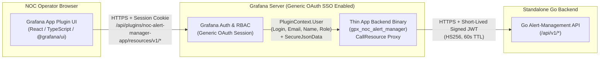

# 01 — Grafana Plugin Architecture & UI/UX Specification

## 1. Purpose & Scope

This document specifies the Grafana frontend/plugin layer for the **NOC Alert-Management System** (`noc-alert-manager-app`). It covers:
- Explicit architectural trade-off analysis between a **Grafana App Plugin** and a **Grafana Panel Plugin** (with a clear final recommendation).
- Plugin manifest (`plugin.json`), routing, RBAC roles/grants, and Grafana Generic OAuth SSO identity passthrough to the Go API service.
- NOC alert triage UI/UX flows modeled closely after the [Grafana Cloud IRM ServiceNow integration](https://grafana.com/docs/grafana-cloud/observe-and-act/respond-to-incidents/integrations/alert-sources/servicenow/), including the **Acknowledge → ServiceNow Incident Action Bar**, **SSO vs. Generic `noc` Caller Selection**, and **Resolved Alert / Open Ticket Drift Visibility**.
- Frontend state management, polling, optimistic concurrency handling, and error/degraded-mode UX.

---

## 2. Architecture Decision: App Plugin vs. Panel Plugin

### 2.1 Trade-Off Comparison Matrix

| Evaluation Dimension | Grafana App Plugin (`"type": "app"`) | Grafana Panel Plugin (`"type": "panel"`) |
|---|---|---|
| **Primary UI Surface** | Full-page, top-level navigation pages (`PluginPage` + React Router) with dedicated queue views, slide-over detail drawers, inline action bars, and admin config tabs. | Constrained to a single dashboard grid widget (`PanelProps`). Multi-step modals, slide-over drawers, and deep filter bars fight dashboard chrome and time-picker controls. |
| **Workflow & Triage Ergonomics** | Native fit for NOC alert queues: persistent filter tabs (`Firing`, `Acknowledged`, `Resolved — Open Ticket`, `Dismissed`), master-detail split pane, keyboard shortcuts, and inline action bars. | Awkward for write-heavy workflows; dashboard auto-refresh intervals can reset local modal/form state unless heavily engineered around dashboard lifecycle hooks. |
| **Backend & Secure API Integration** | Supports **both** a Go backend plugin (`"backend": true`, `CallResource`) and declarative proxy `routes` (`/api/plugin-proxy/<plugin-id>/...`), keeping API secrets in Grafana `secureJsonData`. | Frontend-only by design; cannot run its own `CallResource` backend handler and must rely on a companion Data Source plugin to proxy authenticated requests safely. |
| **SSO User Identity Passthrough** | With a thin Go `CallResource` backend, reads full `backend.PluginContext.User` (`Login`, `Email`, `Name`, `Role`) from Grafana's Generic OAuth session without changing `grafana.ini`. | Cannot read `PluginContext.User` server-side directly; frontend-only user objects (`config.bootData.user`) cannot be trusted by an external API without server-side signing. |
| **RBAC & Permission Model** | First-class plugin RBAC via `plugin.json` `roles` + default `grants` (Grafana 11.3+), gating read, triage, incident creation, and admin settings separately on both OSS and Enterprise/Cloud. | Inherits coarse Dashboard permissions (`View` / `Edit` / `Admin`); cannot cleanly distinguish "can view NOC dashboard" from "can create ServiceNow incidents." |
| **Configuration Management** | Built-in App Config page (`/a/noc-alert-manager-app/config`) backed by Grafana's encrypted `jsonData` / `secureJsonData` store. | Per-panel options stored in dashboard JSON (unencrypted, duplicated across dashboards, unsuitable for API URLs or shared secrets). |
| **Wallboard / Dashboard Embedding** | Can optionally bundle a lightweight companion panel or dashboard JSON inside `includes` later for NOC TV wallboards. | Natively embeds in existing infrastructure dashboards alongside Prometheus metric graphs. |
| **Operational / Build Overhead** | Slightly higher initial packaging (React app + thin Go `CallResource` binary signed/allowed via `allow_loading_unsigned_plugins` for private internal distribution). | Simpler frontend-only bundle, but requires building a separate Data Source plugin anyway to avoid exposing Go API tokens to the browser. |

### 2.2 Final Recommendation

**Recommendation: Build a Grafana App Plugin (`noc-alert-manager-app`) with a thin Go `CallResource` backend proxy.**

**Justification:**
1. **NOC Queue & Triage UX:** Alert triage is a stateful operational console, not a time-series chart. An App Plugin provides dedicated full-page routes, URL-synced filters, a persistent detail drawer, and the contextual **Acknowledge → Create ServiceNow Incident** action bar without fighting dashboard grid layouts.
2. **Trustworthy Generic OAuth SSO Identity:** Because Grafana and ServiceNow share the same corporate SSO IdP via Grafana's Generic OAuth login, operators expect ServiceNow incidents to reflect their SSO identity (with graceful fallback to a generic `noc` user). Grafana App Plugins do **not** have a native `oauthPassThru` toggle like Data Source plugins, and `plugin.json` proxy routes with `[dataproxy] send_user_header = true` forward only `X-Grafana-User` (username), not full email/role claims. A thin `CallResource` backend (~150 lines of Go) solves this cleanly by reading verified `PluginContext.User` (`Login`, `Email`, `Name`, `Role`, `OrgID`) from Grafana's session context, minting a short-lived signed internal JWT, and forwarding requests to the standalone Go API service.
3. **Granular RBAC on OSS & Enterprise:** Declaring `roles` and `grants` in `plugin.json` works immediately on Grafana 11.3+ OSS (mapped to `Viewer`, `Editor`, `Admin`) and unlocks custom per-team RBAC overrides on Grafana Enterprise/Cloud.
4. **Future Wallboard Option:** If NOC operators later want a live counter widget on an overview dashboard, the same App Plugin bundle can include a read-only summary panel under `includes` without changing the API or authentication architecture.

---

## 3. Plugin Architecture & Communication Topology



### 3.1 Why a Thin `CallResource` Proxy + Standalone Go API?

| Responsibility | Thin App Backend (`gpx_noc_alert_manager`) | Standalone Go API Service (`docs/design/02-go-api-service.md`) |
|---|---|---|
| **Lifecycle** | Subprocess managed by Grafana server via HashiCorp `go-plugin` (gRPC). | Independently deployed stateless container/service behind load balancer. |
| **Responsibilities** | 1. Extract verified `PluginContext.User` (`Login`, `Email`, `Name`, `Role`).<br>2. Enforce plugin RBAC action checks.<br>3. Sign a 60-second HS256 JWT using `secureJsonData.apiJwtSecret`.<br>4. Reverse-proxy HTTP requests to `jsonData.apiBaseUrl`. | 1. Alertmanager webhook ingestion (must remain up even if Grafana restarts).<br>2. PostgreSQL state machine, locking, and audit trail.<br>3. ServiceNow Table API integration, SSO user lookup, `noc` fallback, and background drift poller. |
| **Database / SNOW Access** | **None.** Zero DB credentials or SNOW credentials ever touch Grafana. | Owns PostgreSQL pool and ServiceNow credentials exclusively via env vars. |

> **Alternative (Zero-Binary Proxy Mode):** If an organization cannot deploy a signed Go plugin binary inside Grafana, the plugin can run frontend-only using `plugin.json` `routes` (`/api/plugin-proxy/noc-alert-manager-app/api/*`) with Grafana `[dataproxy] send_user_header = true` and a shared `Authorization: Bearer {{ .SecureJsonData.proxySharedToken }}` header. However, this alternative only forwards `X-Grafana-User` (username, not email or role) unless Grafana's signed `X-Grafana-Id` JWT forwarding is also enabled, making SSO email matching in ServiceNow less reliable. See `docs/design/02-go-api-service.md` §6 for the exact dual-mode verification contract.

---

## 4. Plugin Manifest (`plugin.json`) Specification

```json
{
  "$schema": "https://raw.githubusercontent.com/grafana/grafana/main/docs/sources/developers/plugins/plugin.schema.json",
  "type": "app",
  "name": "NOC Alert Manager",
  "id": "noc-alert-manager-app",
  "backend": true,
  "executable": "gpx_noc_alert_manager",
  "info": {
    "description": "NOC alert triage console for Prometheus Alertmanager alerts with ServiceNow incident integration.",
    "version": "1.0.0",
    "links": []
  },
  "dependencies": {
    "grafanaDependency": ">=11.3.0",
    "plugins": []
  },
  "includes": [
    {
      "type": "page",
      "name": "Alert Queue",
      "path": "/a/noc-alert-manager-app/alerts",
      "role": "Viewer",
      "addToNav": true,
      "defaultNav": true
    },
    {
      "type": "page",
      "name": "Configuration",
      "path": "/a/noc-alert-manager-app/config",
      "role": "Admin",
      "addToNav": true
    }
  ],
  "roles": [
    {
      "role": {
        "name": "NOC Alert Viewer",
        "description": "View alert queue, incident links, and audit history.",
        "permissions": [
          { "action": "noc-alert-manager-app.alerts:read" }
        ]
      },
      "grants": ["Viewer"]
    },
    {
      "role": {
        "name": "NOC Operator",
        "description": "Acknowledge, dismiss, reopen alerts, and create or link ServiceNow incidents.",
        "permissions": [
          { "action": "noc-alert-manager-app.alerts:read" },
          { "action": "noc-alert-manager-app.alerts:triage" },
          { "action": "noc-alert-manager-app.incidents:write" }
        ]
      },
      "grants": ["Editor"]
    },
    {
      "role": {
        "name": "NOC Administrator",
        "description": "Configure plugin backend URL, defaults, and full alert administration.",
        "permissions": [
          { "action": "noc-alert-manager-app.alerts:read" },
          { "action": "noc-alert-manager-app.alerts:triage" },
          { "action": "noc-alert-manager-app.incidents:write" },
          { "action": "noc-alert-manager-app.settings:write" }
        ]
      },
      "grants": ["Admin"]
    }
  ]
}
```

### 4.1 Plugin Settings Storage (`jsonData` & `secureJsonData`)

| Storage Location | Field | Purpose |
|---|---|---|
| `jsonData` (non-secret) | `apiBaseUrl` | Base URL of the standalone Go API service (e.g., `https://noc-api.internal.example.com`). |
| `jsonData` (non-secret) | `pollIntervalSeconds` | UI auto-refresh interval in seconds (default `15`, min `5`, max `120`). |
| `jsonData` (non-secret) | `defaultCallerMode` | Default caller selector in SNOW modal: `"sso_user"` (default) or `"generic_noc"`. |
| `jsonData` (non-secret) | `genericNocDisplayLabel` | Display label shown in UI caller picker (e.g., `"Generic NOC (noc)"`). |
| `secureJsonData` (encrypted by Grafana) | `apiJwtSecret` | Shared HMAC secret used by `gpx_noc_alert_manager` to sign short-lived internal JWTs to the Go API (matches `GRAFANA_PLUGIN_JWT_SECRET` on the Go API). |

---

## 5. UI/UX Flows & Screen Specifications

Modeled after the **Grafana Cloud IRM ServiceNow integration** (alert-group list → inline acknowledgement → contextual incident creation/link bar → bi-directional state badge & work-note visibility), tailored specifically for high-throughput NOC triage.

### 5.1 Primary View: NOC Alert Queue (`/a/noc-alert-manager-app/alerts`)

#### Top KPI & Quick-Filter Strip
Displays 4 clickable exclusive bucket tab cards (`KpiFilterStrip.tsx`) populated from `GET /api/v1/alerts` `summary` counts (defaulting to **`Firing`** on load; only `critical` and `warning` alerts are shown or counted):
1. **Firing** (red accent, default active tab) — `state=firing`, count `summary.firing`, with live `summary.firing_critical` / `summary.firing_warning` severity breakdown when non-zero (otherwise *"Unacknowledged active alerts"*).
2. **Acknowledged** (amber accent) — `state=acknowledged`, count `summary.acknowledged`, subtext showing `summary.acknowledged_without_incident` without ticket vs. ticket open.
3. **Non active Acknowledged** (purple accent) — `state=non_active_acknowledged` (`state = 'resolved' AND acknowledged_at IS NOT NULL AND dismissed_at IS NULL`), count `summary.non_active_acknowledged`; when `summary.resolved_open_ticket > 0`, subtext highlights **`<N> open ServiceNow ticket`** drift.
4. **Dismissed** (neutral gray accent) — `state=dismissed`, count `summary.dismissed` (*"Suppressed for episode"*).

#### Filter, Search & Pagination Toolbar
- 250ms debounced free-text search across `alert_name`, team (`labels.team` / `assigned_team`), `fingerprint`, `incident_number` (`INC...`), and `annotations.summary`.
- Filter controls (`FilterToolbar.tsx`): **Env** dropdown (`Env: All` + distinct store values), **Site** dropdown (`Site: All` + distinct store values), **Team** dropdown (`Team: All`, `Team: Untagged`, + distinct Prometheus/operator teams), **Sort** dropdown (`severity_desc` default — Critical before Warning, `starts_at_desc`, `starts_at_asc`, `resolved_at_desc`), **Severity** toggle chips (`critical`, `warning`), and **Label Filter** (`key=value` tags).
- Bulk selection bar (`bulk-selection-bar`): Selecting ≥1 firing/acknowledged alert lets operators **`Dismiss Selected (<N>)`** in one atomic batch (`POST /v1/alerts/bulk/dismiss`) or **`Create Single ServiceNow Incident (<M>)`** for incident-eligible alerts (`MAX_BULK_SELECTION = 50`).
- Auto-refresh toggle (`15s` default) with manual **Refresh** button and last-synced timestamp.
- Keyset pagination bar below the table (`25` / `50` / `100` rows per page, default `50`) showing `Showing X–Y of N · Page P of T`, `« First` / `‹ Prev` / `Next ›`, and preserving Page 2+ during background polling with a non-disruptive `"Queue updated — Jump to Page 1"` pill when counts change.

#### Alert Table Columns
Rendered as a fixed-layout HTML table (`table-layout: fixed; width: 100%` in `AlertTable.tsx`) with sticky headers (`thead`), de-boxed metadata typography (no square pills/badges), and locked column widths identical across tabs so columns never shift:

| Column | Fixed Width | Data Source | Visual Behavior |
|---|---|---|---|
| **Checkbox** *(select)* | `36px` | `isAlertSelectableForIncident(alert)` | Header "Select all eligible alerts" + per-row checkbox (`critical`/`warning` `3px` left accent stripe on cell edge). |
| **Severity** | `92px` | `severity` | Clean bold colored label (`Critical` red, `Warning` orange — `info`/`low`/`unknown` excluded). |
| **Alert** | `auto` *(flex)* | `alert_name`, `annotations.summary`, `previous_episode_count` | Bold clickable alert link (opens detail drawer), inline `"<N> prior"` episode filter link, and 1-line truncated summary. |
| **Env** | `76px` | `environment` (`labels.environment` / `labels.env`) | Plain monospace text or `—`. |
| **Site** | `104px` | `site` (`labels.site`) | Plain monospace text or `—`. |
| **Team** | `124px` | `team`, `team_source`, `assigned_team_by` | Colored dot (`●` blue for Prometheus `labels.team`, purple with tooltip *"Tagged by `<user>`"* for operator tag) + team name, or `—`. |
| **Duration** | `92px` | `starts_at`, `resolved_at`, `version` | Active alerts show relative duration + `v<version>`; resolved alerts show `Res <age>` and `Start <age>`. |
| **ServiceNow** *(acknowledged tabs only)* | `152px` | `servicenow_incident` + `incident_drift_status` | Shown only on `Acknowledged` and `Non active Acknowledged` tabs: clickable link `INC0012345 ↗` + plain state/drift text (`Open Drift` / `Ticket Closed`), `Creating...`, or `SNOW Failed`. |
| **Actions** | `48px` | `RowActionMenu.tsx` | Centered **3-squares** menu trigger opening a portal-mounted contextual menu:<br>- `firing`: **Acknowledge**, **Create ServiceNow Incident**, **Dismiss...**, **View Details**<br>- `acknowledged` (unlinked): **Create ServiceNow Incident**, **Link Existing Incident...**, **Add Triage Note...**, **Unacknowledge**, **Dismiss...**, **View Details**<br>- `acknowledged` (linked): **Add ServiceNow Work Note...**, **Sync ServiceNow Status**, **Add Triage Note...**, **Dismiss...**, **View Details**<br>- `resolved_open_ticket`: **Post Work Note...**, **Refresh ServiceNow Status**, **View Details**<br>- `dismissed`: **Reopen Alert**, **View Details** |

---

### 5.2 Core NOC Triage Flow: Acknowledge → ServiceNow Action Menu

```mermaid
stateDiagram-v2
    [*] --> FiringRow: Alert arrives (state=firing)
    FiringRow --> AckPending: Operator clicks [Acknowledge] in 3-squares menu
    AckPending --> AckTab: 200 OK (moves to Acknowledged tab)
    AckPending --> ConflictToast: 409 Conflict (already acked/resolved)
    ConflictToast --> FiringRow: Auto-refresh row state

    state AckTab {
        [*] --> MenuActions: Contextual actions in 3-squares menu & Drawer
        MenuActions --> CreateModal: Click [Create ServiceNow Incident]
        MenuActions --> LinkModal: Click [Link Existing Incident...]
        MenuActions --> DismissModal: Click [Dismiss...]
        MenuActions --> UnackAction: Click [Unacknowledge]
    }

    CreateModal --> SnowCreating: Submit form (SSO user or Generic NOC)
    SnowCreating --> IncidentLinked: 201 Created (INCxxxxxxx link on Acknowledged tab)
    SnowCreating --> FallbackBanner: 201 Created (caller_resolution_status=fallback_noc)
    SnowCreating --> SnowErrorRetry: 502/503/504 (Alert stays acknowledged; Retry CTA)
```



#### Step-by-Step UX Behavior
1. **Clicking `Acknowledge` (inside a `firing` row's 3-squares `RowActionMenu`):**
   - Calls `POST /api/plugins/noc-alert-manager-app/resources/v1/alerts/{alert_id}/acknowledge` with `{ "version": alert.version }`.
   - On `200 OK`, removes the row from the `Firing` tab, shows a confirmation toast (`Moved to the Acknowledged tab`), and updates the KPI counts (`Acknowledged` tab exposes `Create ServiceNow Incident`, `Link Existing Incident...`, `Add Triage Note...`, `Unacknowledge`, and `Dismiss...` via its 3-squares menu and the Alert Detail Drawer).
2. **Clicking `Create ServiceNow Incident`:**
   - Opens the **Create ServiceNow Incident Drawer/Modal** pre-populated from the alert context and `GET /api/v1/servicenow/metadata`:
     - **Short Description** *(required, max 160 chars)*: Pre-filled as `[<severity>] <alert_name>: <annotations.summary>`.
     - **Description** *(multiline, editable)*: Pre-filled Markdown/text block containing Alert Name, Severity, Starts At (UTC), Fingerprint, all Labels, Annotations (`description`, `runbook_url`), Alertmanager `generatorURL`, and deep link back to this Grafana alert (`/a/noc-alert-manager-app/alerts/{alert_id}`).
     - **Impact** *(1-High, 2-Medium, 3-Low)* & **Urgency** *(1-High, 2-Medium, 3-Low)*: Pre-mapped from alert `severity` (`critical` → Impact 1 / Urgency 1, `warning` → Impact 2 / Urgency 2), displaying the live calculated ServiceNow **Priority** preview (`1 - Critical` through `5 - Planning`).
     - **Assignment Group** *(dropdown/autocomplete)*: Pre-filled from label `labels.assignment_group` or `labels.team` mapping, falling back to `SNOW_DEFAULT_ASSIGNMENT_GROUP`.
     - **Category** *(dropdown)*: Default from `SNOW_DEFAULT_CATEGORY` (e.g., `Infrastructure` / `Software`).
     - **Caller Identity** *(radio toggle — addresses corporate SSO + generic `noc` requirement)*:
       - `Use my SSO account (alice.smith@corp.example)` *(default — resolves operator's email in ServiceNow `sys_user`; automatically falls back to generic `noc` if lookup fails)*
       - `Use generic NOC account (noc)` *(explicitly sets caller to the shared `noc` ServiceNow user)*
     - **Initial Work Notes** *(optional)*: Pre-filled with any acknowledgement note entered by the operator.
   - Submitting sends `POST /api/plugins/noc-alert-manager-app/resources/v1/alerts/{alert_id}/servicenow/incident` with a client-generated UUID `Idempotency-Key` header (held in modal state across manual retries of the same submission to prevent duplicate tickets).
3. **Post-Creation Feedback:**
   - **Standard Success (`caller_resolution_status: "sso_matched"` or `"generic_noc_selected"`):** Action bar updates in place to show **`INC0012345`** (`New`), clickable **`Open in ServiceNow ↗`**, **`Sync Status`**, and **`Add Work Note`**.
   - **Success with SSO Fallback (`caller_resolution_status: "fallback_noc"`):** Incident is linked normally AND a dismissible info banner displays: *"Incident `INC0012345` created using the generic `noc` account because your SSO account (`alice.smith@corp.example`) could not be matched in ServiceNow."*
   - **ServiceNow Failure (`502` / `503` / `504`):** The alert **remains `acknowledged`** (triage is never rolled back). The modal remains open with form values preserved and displays a clear error alert with a **`Retry Creation`** button reusing the same `Idempotency-Key`.
4. **Multi-Alert Selection & Bulk ServiceNow Incident Creation:**
   - Operators can select up to `50` eligible (`firing` or `acknowledged`, unlinked) alerts via the table checkboxes (`MAX_BULK_SELECTION = 50`; checkboxes cap at 50 with an inline notice). A bulk selection bar displays the selected count, notes how many `firing` alerts will be auto-acknowledged, and exposes **`Create Single ServiceNow Incident (<N>)`**.
   - Opening the modal with multiple alerts (or any `firing` alert) shows an **Included Alerts** list and submits `POST /api/plugins/noc-alert-manager-app/resources/v1/servicenow/incidents/bulk` with `alert_ids` and an `Idempotency-Key` header, auto-acknowledging any `firing` alerts and linking all selected alerts to one ServiceNow incident.
   - On `409 Conflict`, `CreateIncidentModal` disables retry, surfaces the conflicting alert and incident/state details inside the modal, and refreshes the queue immediately.
   - Selections that disappear or gain a linked incident on background refresh are automatically pruned from `selectedAlertIds`.

---

### 5.3 Resolved Alert with Open Ticket Workflow (`resolved_open_ticket`)

When an alert was acknowledged, a ServiceNow incident was created, and Prometheus Alertmanager subsequently sends `status: "resolved"` while the owning engineering team has **not** resolved/closed the ServiceNow ticket:
1. The alert transitions to `state: "resolved"` in PostgreSQL, while `servicenow_incidents.snow_state` remains `1` (`New`), `2` (`In Progress`), or `3` (`On Hold`).
2. The **"Non active Acknowledged"** bucket card updates its subtext to highlight `<N> open ServiceNow ticket` (`summary.resolved_open_ticket`).
3. Selecting **`Drift: Resolved w/ Open Ticket`** in the ServiceNow status filter switches to the `Non active Acknowledged` bucket and queries `GET /api/v1/alerts?state=non_active_acknowledged&incident_drift=resolved_open_ticket`.
4. Opening the alert detail drawer displays a prominent **Drift Callout Banner**:
   - *"Alert stopped firing at `2026-11-25 18:12:04 UTC` (42m ago), but ServiceNow incident `INC0012345` is still **In Progress** (last synced 2m ago)."*
   - Inline buttons:
     - **`Refresh SNOW Status`** → `POST .../servicenow/sync` (forces immediate live lookup from ServiceNow).
     - **`Post Resolution Nudge to SNOW`** → opens pre-filled work note modal (*"Alert resolved in Prometheus at <ends_at>. Please verify recovery and resolve/close this incident."*) → `POST .../servicenow/work-notes`.
     - **`Open INC0012345 ↗`** → opens the incident directly in ServiceNow.

---

### 5.4 Alert Detail Drawer & Audit Timeline

Clicking any row opens a right-hand slide-over drawer (URL-addressable at `/a/noc-alert-manager-app/alerts/:alertId`) with a **Connected Team** card above 4 tabs:
- **Connected Team Card:** Displays the resolved owning team (`team_source: "label"` blue badge from Prometheus `labels.team`, or `team_source: "operator"` purple badge with *"Change Team"* button). When no team is connected (`team_source: "none"`) or editing, Editors/Admins can type a team name or pick a quick-select chip (seeded from `metadata.assignment_groups` + defaults) to call `POST /api/plugins/noc-alert-manager-app/resources/v1/alerts/{alert_id}/team`. Operator tags are stored by `fingerprint` and inherited automatically on future re-fires.
1. **Overview:** State banner, ServiceNow Action Bar (or linked incident card + drift banner), summary/description annotations, `generatorURL` ("Open in Prometheus ↗"), `runbook_url` ("Open Runbook ↗"), and full `labels` key-value table.
2. **ServiceNow:** Linked incident metadata (`number`, `sys_id`, `state`, `priority`, `assignment_group`, `caller_resolution_status`, `snow_state_synced_at`), quick work-note composer, and manual sync button.
3. **Audit Timeline:** Chronological feed from `GET /api/v1/alerts/{alert_id}/history` showing every event (`alert_fired`, `alert_acknowledged`, `snow_incident_created`, `snow_caller_fallback`, `alert_resolved`, `snow_state_synced`, etc.) with actor identity, timestamp, and comments.
4. **Past Episodes:** Historical list of earlier resolved/dismissed episodes sharing the same `fingerprint` (showing whether previous occurrences spawned incidents), making recurring/flapping issues immediately obvious without suppressing or auto-acknowledging the new firing episode.

---

### 5.5 Role-Based UI Gating

The frontend reads the user's granted plugin permissions via Grafana's `@grafana/runtime` access-control utilities (`contextSrv.hasPermission` / RBAC action checks) to hide or disable unauthorized controls (while the backend remains the authoritative enforcement boundary):

| UI Control | Required Action (`plugin.json`) | Viewer | Editor | Admin |
|---|---|---|---|---|
| View Alert Queue, Detail Drawer, Audit Log, Past Episodes | `noc-alert-manager-app.alerts:read` | Allowed | Allowed | Allowed |
| Acknowledge, Unacknowledge, Dismiss, Reopen, Add Note, Tag Team | `noc-alert-manager-app.alerts:triage` | Disabled (tooltip) | Allowed | Allowed |
| Create/Link SNOW Incident (single or bulk*), Post Work Note, Sync SNOW Status | `noc-alert-manager-app.incidents:write` | Disabled (tooltip) | Allowed | Allowed |
| Edit Plugin Configuration (`/config`) | `noc-alert-manager-app.settings:write` | Hidden | Hidden | Allowed |

*\*Bulk creation that includes any `firing` alert also requires `noc-alert-manager-app.alerts:triage` to auto-acknowledge those alerts (enforced in both `AlertQueuePage.tsx` and the Go API).*

---

## 6. Frontend State Management, Polling & Concurrency UX

1. **Data Fetching:** Use `@grafana/runtime` `getBackendSrv()` targeting `/api/plugins/noc-alert-manager-app/resources/v1/...`. All API calls include standard JSON `Content-Type` and `Accept` headers; authentication cookies are sent automatically by the browser to Grafana.
2. **Polling & Pause Rules:**
   - The alert queue polls `GET /v1/alerts` every `pollIntervalSeconds` (default `15s`) using `AbortController` to cancel in-flight stale requests.
   - Polling pauses automatically when `document.visibilityState === 'hidden'` and resumes immediately on tab focus.
   - Polling updates the background table rows **without** clobbering open modals (Create Incident / Dismiss forms hold isolated local React state).
3. **Optimistic Concurrency (`409 Conflict`) Handling:**
   - Every state-mutating request (`acknowledge`, `dismiss`, `unacknowledge`, `reopen`) sends the alert's current `version`.
   - If another NOC operator (or an Alertmanager `resolved` webhook) modified the alert first, the Go API returns `409 Conflict` containing the latest alert snapshot.
   - The UI immediately updates that row with the returned snapshot and displays an informative toast (e.g., *"Alert was already acknowledged by bob.jones 5s ago"* or *"Alert resolved before your action completed"*).
4. **Graceful Degradation:**
   - If the Go API returns `503` or times out, the UI retains the last known alert list with a top warning banner (*"Live updates paused — Go API unreachable"*) and exponential backoff polling up to `60s`.
   - If ServiceNow is degraded, triage controls (`Acknowledge`, `Dismiss`) remain 100% functional; only SNOW creation/sync actions display non-blocking retry notices.
