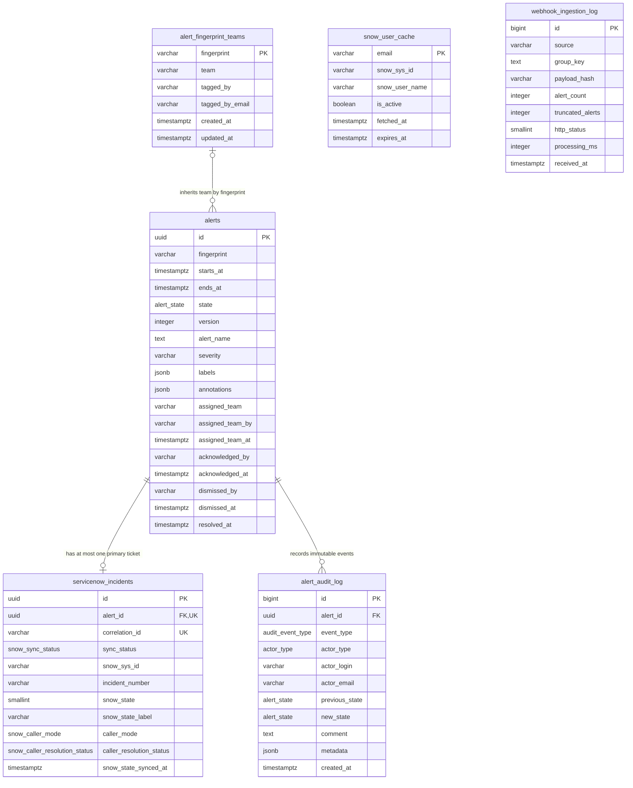

# 03 — PostgreSQL State Store & Relational Schema Specification

## 1. Design Principles & Episode Identity Model

PostgreSQL (v15+) is the authoritative relational state store for alert episodes, ServiceNow incident links, SSO user lookup caching, and the immutable NOC audit log.

### 1.1 Alertmanager `fingerprint` vs. Alert Episode Identity

A critical property of Prometheus Alertmanager is that **`fingerprint` is a 64-bit hash of the alert's label set (`labels`) — NOT a unique identifier for a single outage**.
- When an alert fires at `10:00Z`, resolves at `10:30Z`, and fires again at `14:00Z` with identical labels, Alertmanager emits the **exact same `fingerprint`** with a **new `startsAt` (`14:00Z`)**.
- Per the NOC operational requirement: **if an alert was acknowledged, fixed/resolved, and later fires again, it MUST begin as a brand-new `firing` alert without carrying over the prior acknowledgement.**

Therefore, the schema models each firing lifecycle as an **Alert Episode**:
1. **Surrogate Primary Key:** `alerts.id` (`UUID`, generated via `gen_random_uuid()`) — stable API identifier and ServiceNow `correlation_id`.
2. **Episode Deduplication Key:** `UNIQUE (fingerprint, starts_at)` — guarantees that duplicate or repeat Alertmanager webhook deliveries for the same firing episode always map idempotently to the exact same row.
3. **Single Open Episode Invariant:** A partial unique index `UNIQUE (fingerprint) WHERE state IN ('firing', 'acknowledged', 'dismissed')` guarantees at the database constraint level that **at most one active/open episode can exist per `fingerprint` at any moment**. Once an episode transitions to `resolved`, the partial index releases the `fingerprint`, allowing a subsequent re-fire with a new `starts_at` to insert a fresh `firing` row cleanly.

---

## 2. Entity-Relationship Diagram



---

## 3. Formal Alert State Machine

### 3.1 Allowed States (`alert_state`)
- `firing`: Alert is actively firing in Prometheus/Alertmanager and awaits NOC triage.
- `acknowledged`: A NOC operator has claimed ownership; the UI surfaces the ServiceNow incident Action Bar.
- `dismissed`: A NOC operator explicitly dismissed this firing episode (e.g., maintenance/noise); repeat webhook notifications for the same `(fingerprint, starts_at)` remain `dismissed`.
- `resolved`: Alertmanager reported `status = "resolved"` (the underlying condition cleared). Terminal state for this episode.

### 3.2 Transition Rules & Invariants

| From State | Trigger / Actor | To State | Side Effects & Notes |
|---|---|---|---|
| *(none)* | Alertmanager `firing` webhook (new `(fingerprint, starts_at)`) | `firing` | Inserts new `alerts` row (`version = 1`), logs `alert_fired`. |
| `firing` | Alertmanager `firing` webhook (repeat, same `(fingerprint, starts_at)`) | `firing` | Updates `labels`, `annotations`, `last_received_at`, `delivery_count += 1`. No state transition; logs `alert_updated` only if labels/annotations changed. |
| `firing` | Operator `POST /acknowledge` | `acknowledged` | Sets `acknowledged_by`, `acknowledged_by_email`, `acknowledged_at = NOW()`, `version += 1`; logs `alert_acknowledged`. |
| `firing` | Operator `POST /servicenow/incidents/bulk` | `acknowledged` | Auto-acknowledges selected `firing` alerts inside Tx 1 (`version += 1`, logs `alert_acknowledged` with `auto_acknowledged_by_incident: true`), then reserves pending `servicenow_incidents` rows. |
| `firing` | Operator `POST /dismiss` | `dismissed` | Sets `dismissed_by`, `dismissed_by_email`, `dismissed_at = NOW()`, `dismiss_reason`, `version += 1`; logs `alert_dismissed`. |
| `firing` | Alertmanager `resolved` webhook | `resolved` | Sets `ends_at`, `resolved_at = COALESCE(ends_at, NOW())`, `version += 1`; logs `alert_resolved`. |
| `acknowledged` | Alertmanager `firing` webhook (repeat, same `(fingerprint, starts_at)`) | `acknowledged` | **Preserves `acknowledged` state**; refreshes `annotations`/`last_received_at`/`delivery_count`. |
| `acknowledged` | Operator `POST /unacknowledge` | `firing` | Clears `acknowledged_*`, `version += 1`; logs `alert_unacknowledged`. Linked SNOW incident (if any) remains attached. |
| `acknowledged` | Operator `POST /dismiss` | `dismissed` | Sets `dismissed_*`, `dismiss_reason`, `version += 1`; logs `alert_dismissed`. |
| `acknowledged` | Alertmanager `resolved` webhook | `resolved` | Sets `ends_at`, `resolved_at`, `version += 1`; logs `alert_resolved`. **If linked `servicenow_incidents.snow_state IN (1, 2, 3)`, episode immediately surfaces under `incident_drift = resolved_open_ticket`.** |
| `dismissed` | Alertmanager `firing` webhook (repeat, same `(fingerprint, starts_at)`) | `dismissed` | **Preserves `dismissed` state**; increments `delivery_count`. |
| `dismissed` | Operator `POST /reopen` | `firing` | Clears `dismissed_*`, `version += 1`; logs `alert_reopened`. |
| `dismissed` | Alertmanager `resolved` webhook | `resolved` | Sets `ends_at`, `resolved_at`, `version += 1`; logs `alert_resolved`. |
| `resolved` | Alertmanager `resolved` webhook (duplicate) | `resolved` | Idempotent no-op (updates `last_received_at` only). |
| `resolved` | Alertmanager `firing` webhook (**same** `starts_at` — out-of-order delayed delivery) | `resolved` | Ignored as stale out-of-order delivery (cannot un-resolve an already resolved episode with the same `starts_at`). |
| `resolved` | Alertmanager `firing` webhook (**new** `starts_at > prev.starts_at`) | *(new row)* `firing` | **Creates a brand-new `alerts` row** (`id = gen_random_uuid()`, `state = 'firing'`, `acknowledged_by = NULL`, `version = 1`). |
| `resolved` | Operator `POST /acknowledge` or `POST /dismiss` | *(rejected)* | Returns `409 INVALID_STATE_TRANSITION` (terminal episode). |
| *(any)* | Operator `POST /alerts/{id}/team` | *(unchanged)* | Sets `assigned_team`, `assigned_team_by`, `assigned_team_at = NOW()`, upserts `alert_fingerprint_teams`, logs `alert_team_tagged`. |

---

## 4. Complete PostgreSQL DDL

```sql
-- Requires PostgreSQL 15+ (pgcrypto optional; gen_random_uuid() is built-in since PG 13)

-- ============================================================================
-- 1. ENUM TYPES
-- ============================================================================

CREATE TYPE alert_state AS ENUM (
    'firing',
    'acknowledged',
    'dismissed',
    'resolved'
);

CREATE TYPE snow_sync_status AS ENUM (
    'pending',   -- Reservation inserted before calling ServiceNow API
    'created',   -- Newly created via POST /api/now/table/incident
    'linked',    -- Manually linked to an existing ServiceNow incident
    'failed'     -- Outbound creation failed; eligible for safe retry
);

CREATE TYPE snow_caller_mode AS ENUM (
    'sso_user',     -- Operator chose their Grafana SSO email identity
    'generic_noc'   -- Operator explicitly chose the generic 'noc' account
);

CREATE TYPE snow_caller_resolution_status AS ENUM (
    'pending',
    'sso_matched',           -- Matched active sys_user in ServiceNow by email/login
    'generic_noc_selected',  -- Operator explicitly selected generic 'noc'
    'fallback_noc'           -- SSO lookup failed/unmatched; fell back to generic 'noc'
);

CREATE TYPE audit_event_type AS ENUM (
    'alert_fired',
    'alert_updated',
    'alert_resolved',
    'alert_acknowledged',
    'alert_unacknowledged',
    'alert_dismissed',
    'alert_reopened',
    'alert_team_tagged',     -- Added in migration 0002_team_tags.up.sql
    'operator_note_added',
    'snow_incident_requested',
    'snow_incident_created',
    'snow_incident_failed',
    'snow_incident_linked',
    'snow_caller_fallback',
    'snow_state_synced',
    'snow_work_note_posted'
);

CREATE TYPE actor_type AS ENUM (
    'operator',
    'alertmanager',
    'servicenow',
    'system'
);

-- ============================================================================
-- 2. ALERTS TABLE (ONE ROW PER FIRING EPISODE)
-- ============================================================================

CREATE TABLE alerts (
    id                    UUID PRIMARY KEY DEFAULT gen_random_uuid(),
    fingerprint           VARCHAR(64) NOT NULL,
    starts_at             TIMESTAMPTZ NOT NULL,
    ends_at               TIMESTAMPTZ NULL,
    state                 alert_state NOT NULL DEFAULT 'firing',
    version               INTEGER NOT NULL DEFAULT 1 CHECK (version >= 1),

    -- Alertmanager metadata
    alert_name            TEXT NOT NULL,
    severity              VARCHAR(32) NOT NULL DEFAULT 'unknown',
    group_key             TEXT NOT NULL,
    receiver              TEXT NOT NULL,
    labels                JSONB NOT NULL DEFAULT '{}'::jsonb,
    annotations           JSONB NOT NULL DEFAULT '{}'::jsonb,
    generator_url         TEXT NULL,
    external_url          TEXT NULL,

    -- Operator triage state
    acknowledged_by       VARCHAR(255) NULL,
    acknowledged_by_email VARCHAR(255) NULL,
    acknowledged_at       TIMESTAMPTZ NULL,
    dismissed_by          VARCHAR(255) NULL,
    dismissed_by_email    VARCHAR(255) NULL,
    dismissed_at          TIMESTAMPTZ NULL,
    dismiss_reason        TEXT NULL,
    resolved_at           TIMESTAMPTZ NULL,

    -- Operator team tagging (added in migration 0002_team_tags.up.sql)
    assigned_team         VARCHAR(128) NULL,
    assigned_team_by      VARCHAR(255) NULL,
    assigned_team_at      TIMESTAMPTZ NULL,

    -- Ingestion bookkeeping
    first_received_at     TIMESTAMPTZ NOT NULL DEFAULT NOW(),
    last_received_at      TIMESTAMPTZ NOT NULL DEFAULT NOW(),
    delivery_count        INTEGER NOT NULL DEFAULT 1 CHECK (delivery_count >= 1),
    created_at            TIMESTAMPTZ NOT NULL DEFAULT NOW(),
    updated_at            TIMESTAMPTZ NOT NULL DEFAULT NOW(),

    -- Episode deduplication key: same label set + same start timestamp = same episode
    CONSTRAINT uq_alerts_fingerprint_starts_at UNIQUE (fingerprint, starts_at),

    -- State integrity checks
    CONSTRAINT chk_alerts_ack_fields CHECK (
        state <> 'acknowledged' OR (acknowledged_by IS NOT NULL AND acknowledged_at IS NOT NULL)
    ),
    CONSTRAINT chk_alerts_dismiss_fields CHECK (
        state <> 'dismissed' OR (dismissed_by IS NOT NULL AND dismissed_at IS NOT NULL)
    ),
    CONSTRAINT chk_alerts_resolved_fields CHECK (
        state <> 'resolved' OR resolved_at IS NOT NULL
    )
);

-- ============================================================================
-- 3. SERVICENOW INCIDENTS TABLE (1:0..1 PER ALERT EPISODE)
-- ============================================================================

CREATE TABLE servicenow_incidents (
    id                        UUID PRIMARY KEY DEFAULT gen_random_uuid(),
    alert_id                  UUID NOT NULL REFERENCES alerts(id) ON DELETE CASCADE,
    correlation_id            VARCHAR(128) NOT NULL, -- Defaults to alert_id::text for SNOW idempotency
    sync_status               snow_sync_status NOT NULL DEFAULT 'pending',

    -- ServiceNow record identity & URL
    snow_sys_id               VARCHAR(64) NULL,
    incident_number           VARCHAR(40) NULL,      -- e.g. INC0012345
    incident_url              TEXT NULL,

    -- ServiceNow lifecycle state (OOB values: 1=New, 2=In Progress, 3=On Hold, 6=Resolved, 7=Closed, 8=Canceled)
    snow_state                SMALLINT NULL CHECK (snow_state IS NULL OR snow_state IN (1, 2, 3, 6, 7, 8)),
    snow_state_label          VARCHAR(32) NULL,
    impact                    SMALLINT NOT NULL DEFAULT 2 CHECK (impact BETWEEN 1 AND 3),
    urgency                   SMALLINT NOT NULL DEFAULT 2 CHECK (urgency BETWEEN 1 AND 3),
    priority                  SMALLINT NULL CHECK (priority IS NULL OR priority BETWEEN 1 AND 5),

    -- Submitted ticket metadata
    short_description         VARCHAR(160) NOT NULL,
    description               TEXT NULL,
    assignment_group          VARCHAR(128) NULL,
    category                  VARCHAR(64) NULL,

    -- Caller attribution (SSO vs Generic NOC fallback)
    caller_mode               snow_caller_mode NOT NULL DEFAULT 'sso_user',
    caller_resolution_status  snow_caller_resolution_status NOT NULL DEFAULT 'pending',
    caller_sys_id             VARCHAR(64) NULL,
    caller_fallback_reason    TEXT NULL,

    -- Audit & sync tracking
    created_by_login          VARCHAR(255) NOT NULL,
    created_by_email          VARCHAR(255) NULL,
    snow_opened_at            TIMESTAMPTZ NULL,
    snow_resolved_at          TIMESTAMPTZ NULL,
    snow_closed_at            TIMESTAMPTZ NULL,
    snow_state_synced_at      TIMESTAMPTZ NULL,
    resolution_note_posted_at TIMESTAMPTZ NULL, -- Prevents duplicate auto-nudge work notes when alert resolves
    last_error                TEXT NULL,
    retry_count               INTEGER NOT NULL DEFAULT 0 CHECK (retry_count >= 0),
    created_at                TIMESTAMPTZ NOT NULL DEFAULT NOW(),
    updated_at                TIMESTAMPTZ NOT NULL DEFAULT NOW(),

    -- Guarantees at most one primary ticket record per alert episode
    CONSTRAINT uq_snow_incidents_alert_id UNIQUE (alert_id),
    -- Guarantees unique correlation_id for newly created incidents
    CONSTRAINT uq_snow_incidents_correlation_id UNIQUE (correlation_id),
    CONSTRAINT chk_snow_created_has_sys_id CHECK (
        sync_status NOT IN ('created', 'linked') OR (snow_sys_id IS NOT NULL AND incident_number IS NOT NULL)
    )
);

-- ============================================================================
-- 4. IMMUTABLE AUDIT LOG TABLE
-- ============================================================================

CREATE TABLE alert_audit_log (
    id             BIGSERIAL PRIMARY KEY,
    alert_id       UUID NOT NULL REFERENCES alerts(id) ON DELETE CASCADE,
    event_type     audit_event_type NOT NULL,
    actor_type     actor_type NOT NULL,
    actor_login    VARCHAR(255) NOT NULL,
    actor_email    VARCHAR(255) NULL,
    actor_role     VARCHAR(64) NULL,
    previous_state alert_state NULL,
    new_state      alert_state NULL,
    comment        TEXT NULL,
    metadata       JSONB NOT NULL DEFAULT '{}'::jsonb,
    created_at     TIMESTAMPTZ NOT NULL DEFAULT NOW()
);

-- ============================================================================
-- 5. SERVICENOW SSO USER LOOKUP CACHE
-- ============================================================================

CREATE TABLE snow_user_cache (
    email          VARCHAR(255) PRIMARY KEY, -- Lowercased SSO email (or login in fallback mode)
    snow_sys_id    VARCHAR(64) NULL,         -- NULL caches negative misses briefly to avoid SNOW hammering
    snow_user_name VARCHAR(128) NULL,
    is_active      BOOLEAN NOT NULL DEFAULT FALSE,
    fetched_at     TIMESTAMPTZ NOT NULL DEFAULT NOW(),
    expires_at     TIMESTAMPTZ NOT NULL
);

-- ============================================================================
-- 6. WEBHOOK INGESTION LOG (OPERATIONAL AUDIT & TRUNCATION VISIBILITY)
-- ============================================================================

CREATE TABLE webhook_ingestion_log (
    id               BIGSERIAL PRIMARY KEY,
    source           VARCHAR(32) NOT NULL CHECK (source IN ('alertmanager', 'servicenow')),
    group_key        TEXT NULL,
    payload_hash     VARCHAR(64) NOT NULL,
    alert_count      INTEGER NOT NULL DEFAULT 0,
    truncated_alerts INTEGER NOT NULL DEFAULT 0,
    http_status      SMALLINT NOT NULL,
    processing_ms    INTEGER NOT NULL,
    error_message    TEXT NULL,
    received_at      TIMESTAMPTZ NOT NULL DEFAULT NOW()
);

-- ============================================================================
-- 7. FINGERPRINT TEAM TAGS (ADDED IN MIGRATION 0002_team_tags.up.sql)
-- ============================================================================

CREATE TABLE alert_fingerprint_teams (
    fingerprint     VARCHAR(64) PRIMARY KEY,
    team            VARCHAR(128) NOT NULL,
    tagged_by       VARCHAR(255) NOT NULL,
    tagged_by_email VARCHAR(255) NULL,
    created_at      TIMESTAMPTZ NOT NULL DEFAULT NOW(),
    updated_at      TIMESTAMPTZ NOT NULL DEFAULT NOW()
);

CREATE TRIGGER trg_alert_fingerprint_teams_updated_at
    BEFORE UPDATE ON alert_fingerprint_teams
    FOR EACH ROW
    EXECUTE FUNCTION set_updated_at();

-- ============================================================================
-- 8. IDEMPOTENCY KEYS (ADDED IN MIGRATION 0003_idempotency_keys.up.sql)
-- ============================================================================

CREATE TABLE idempotency_keys (
    idempotency_key VARCHAR(128) PRIMARY KEY,
    endpoint        VARCHAR(128) NOT NULL,
    request_hash    VARCHAR(64) NOT NULL,
    actor_login     VARCHAR(255) NOT NULL,
    status          VARCHAR(16) NOT NULL CHECK (status IN ('in_progress', 'completed')),
    response_status SMALLINT NULL,
    response_body   JSONB NULL,
    created_at      TIMESTAMPTZ NOT NULL DEFAULT NOW(),
    updated_at      TIMESTAMPTZ NOT NULL DEFAULT NOW(),
    expires_at      TIMESTAMPTZ NOT NULL
);

CREATE TRIGGER trg_idempotency_keys_updated_at
    BEFORE UPDATE ON idempotency_keys
    FOR EACH ROW
    EXECUTE FUNCTION set_updated_at();
```

---

## 5. Indexing Strategy

```sql
-- 1. Enforce at most ONE open episode per Alertmanager fingerprint
CREATE UNIQUE INDEX uq_alerts_active_fingerprint
    ON alerts (fingerprint)
    WHERE state IN ('firing', 'acknowledged', 'dismissed');

-- 2. Primary NOC queue listing & keyset pagination (default sort: starts_at DESC, id DESC)
CREATE INDEX idx_alerts_state_starts_at
    ON alerts (state, starts_at DESC, id DESC);

-- 3. Severity filtering on active queue
CREATE INDEX idx_alerts_active_severity
    ON alerts (severity, starts_at DESC)
    WHERE state IN ('firing', 'acknowledged');

-- 4. Historical episode lookup by fingerprint ("Past Episodes" tab & previous_episode_count)
CREATE INDEX idx_alerts_fingerprint_starts_at_desc
    ON alerts (fingerprint, starts_at DESC);

-- 5. JSONB label containment filtering (e.g., labels @> '{"cluster":"prod-eu1"}')
CREATE INDEX idx_alerts_labels_gin
    ON alerts USING GIN (labels jsonb_path_ops);

-- 6. Fast background poller query & "Resolved — Open Ticket" drift view:
--    Targets only linked/created incidents still open in ServiceNow (New, In Progress, On Hold)
CREATE INDEX idx_snow_incidents_open_sync
    ON servicenow_incidents (snow_state_synced_at ASC NULLS FIRST)
    WHERE sync_status IN ('created', 'linked') AND snow_state IN (1, 2, 3);

-- 7. Fast lookup for inbound ServiceNow webhook updates by snow_sys_id or incident_number
--    (Non-unique because multiple alert episodes may manually link to the same existing incident)
CREATE INDEX idx_snow_incidents_sys_id
    ON servicenow_incidents (snow_sys_id)
    WHERE snow_sys_id IS NOT NULL;

CREATE INDEX idx_snow_incidents_number
    ON servicenow_incidents (incident_number)
    WHERE incident_number IS NOT NULL;

-- 8. Audit timeline lookup per alert episode
CREATE INDEX idx_audit_log_alert_id_created
    ON alert_audit_log (alert_id, created_at ASC, id ASC);

-- 9. Cache cleanup / expiry scan
CREATE INDEX idx_snow_user_cache_expires_at
    ON snow_user_cache (expires_at);

-- 10. Retention cleanup for webhook_ingestion_log
CREATE INDEX idx_webhook_ingestion_log_received_at
    ON webhook_ingestion_log (received_at);

-- 11. Non-Active Acknowledged bucket (added in migration 0002_team_tags.up.sql)
CREATE INDEX idx_alerts_non_active_ack
    ON alerts (resolved_at DESC, id DESC)
    WHERE state = 'resolved' AND acknowledged_at IS NOT NULL;

-- 12. Idempotency key expiry purge (added in migration 0003_idempotency_keys.up.sql)
CREATE INDEX idx_idempotency_keys_expires_at
    ON idempotency_keys (expires_at);

-- 13. Critical-first keyset pagination on Critical/Warning active queues (added in migration 0004_severity_sort_index.up.sql)
CREATE INDEX idx_alerts_active_severity_rank
    ON alerts (
        state,
        (CASE severity WHEN 'critical' THEN 1 WHEN 'warning' THEN 2 WHEN 'info' THEN 3 ELSE 4 END),
        starts_at DESC,
        id DESC
    )
    WHERE state IN ('firing', 'acknowledged', 'dismissed')
      AND severity IN ('critical', 'warning');
```

### 5.1 Query for "Resolved — Open Ticket" Drift Detection

This query directly powers the NOC UI's **`Resolved — Open Ticket`** counter card and filter (`GET /api/v1/alerts?incident_drift=resolved_open_ticket`):

```sql
SELECT
    a.*,
    s.id                    AS snow_record_id,
    s.sync_status,
    s.snow_sys_id,
    s.incident_number,
    s.incident_url,
    s.snow_state,
    s.snow_state_label,
    s.priority,
    s.assignment_group,
    s.caller_mode,
    s.caller_resolution_status,
    s.snow_state_synced_at
FROM alerts a
INNER JOIN servicenow_incidents s ON s.alert_id = a.id
WHERE a.state = 'resolved'
  AND s.sync_status IN ('created', 'linked')
  AND s.snow_state IN (1, 2, 3) -- New, In Progress, On Hold (team has not resolved ticket)
ORDER BY a.resolved_at DESC, a.id DESC
LIMIT $1;
```

Because `idx_snow_incidents_open_sync` only indexes open ServiceNow tickets (typically dozens to low hundreds of rows even when `alerts` holds millions of resolved historical rows), this join executes in sub-millisecond time.

---

## 6. Immutability, Retention & Operational Maintenance

1. **Audit Log Immutability & Least-Privilege Grants (`backend/internal/migrate/runner.go`):** After applying migrations, `migrate up` executes `GrantAppRole` for `POSTGRES_APP_USER` (default `alert_api_app`):
   - `GRANT USAGE ON SCHEMA public`
   - `GRANT SELECT, INSERT, UPDATE, DELETE ON alerts, servicenow_incidents, snow_user_cache, webhook_ingestion_log, alert_fingerprint_teams, idempotency_keys`
   - `GRANT SELECT, INSERT ON alert_audit_log` and explicit `REVOKE UPDATE, DELETE ON alert_audit_log` (preventing audit log tampering even if an application bug occurs)
   - `GRANT SELECT ON schema_migrations` and `GRANT USAGE, SELECT ON ALL SEQUENCES IN SCHEMA public`
2. **Retention Policy (Configurable Background Job):**
   - `webhook_ingestion_log`: purge rows older than `30 days` via batched deletes (`LIMIT 10000`).
   - `snow_user_cache`: positive matches cached for `6 hours`, negative misses cached for `5 minutes`; expired rows purged hourly (`PurgeExpiredUserCache`).
   - `idempotency_keys`: `24 hours` TTL; expired rows purged hourly (`PurgeExpiredIdempotencyKeys`).
   - `alerts` + `servicenow_incidents` + `alert_audit_log`: retain `resolved` episodes whose linked ServiceNow ticket (if any) is `Closed`/`Canceled`/`Resolved` (or absent) for `180 days` (configurable for compliance), then archive to cold storage or drop monthly partitions if volume exceeds 5M alerts/year. **Never purge a `resolved` alert while its linked ServiceNow ticket is still open (`snow_state IN (1, 2, 3)`).**
3. **Trigger for `updated_at`:** A lightweight `BEFORE UPDATE` trigger (`set_updated_at()`) maintains `updated_at = NOW()` on `alerts`, `servicenow_incidents`, `alert_fingerprint_teams`, and `idempotency_keys` automatically.
4. **Migration Rollback Note:** `migrations/0002_team_tags.down.sql` documents PostgreSQL's `DROP VALUE` limitation on enum types: rolling back `0002` drops `idx_alerts_non_active_ack`, `trg_alert_fingerprint_teams_updated_at`, `alert_fingerprint_teams`, and `alerts.assigned_team*` columns, while `'alert_team_tagged'` remains in `audit_event_type` unless the enum is manually recreated.
