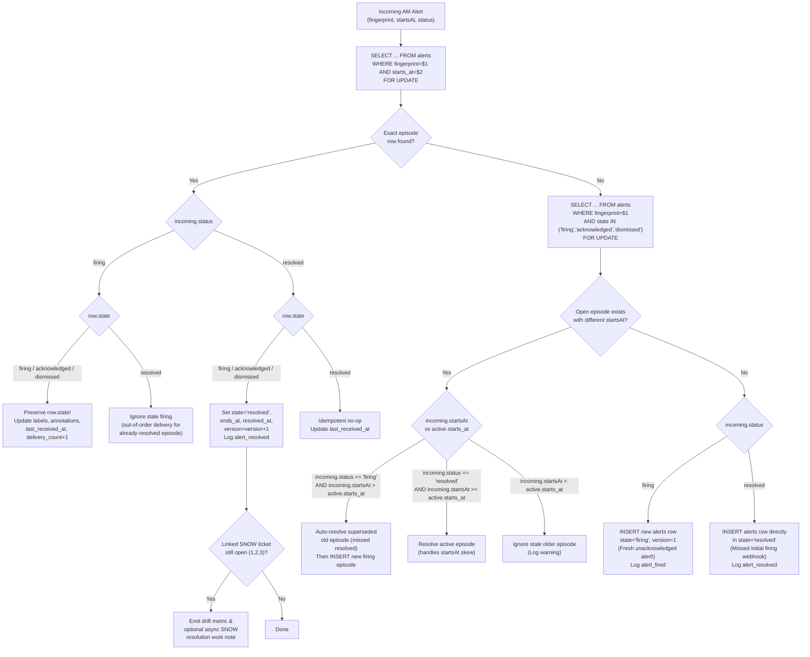

# 04 — Alertmanager Webhook Ingestion & Reconciliation Specification

## 1. Purpose & Scope

This document defines the contract between **Prometheus Alertmanager** (`<webhook_config>`) and the Go backend API's ingestion endpoint (`POST /api/v1/webhooks/alertmanager`). It specifies the verified Alertmanager v4 payload schema, exact field mapping to PostgreSQL, state reconciliation logic (new alerts, repeat notifications, resolved alerts, out-of-order deliveries, and re-firing episodes), HTTP status code semantics for Alertmanager retry/backoff, and operational safeguards.

---

## 2. Alertmanager Configuration (`alertmanager.yml`)

```yaml
receivers:
  - name: "noc-alert-api"
    webhook_configs:
      - url: "https://noc-api.internal.example.com/api/v1/webhooks/alertmanager"
        send_resolved: true   # REQUIRED: enables 'resolved' state & open-ticket drift detection
        max_alerts: 0         # RECOMMENDED: 0 = no truncation so every alert episode is reconciled
        timeout: 10s
        http_config:
          bearer_token_file: "/etc/alertmanager/secrets/noc_webhook_token"
```

### Critical Configuration Requirements
- **`send_resolved: true`** is mandatory. Without it, the Go API would never learn that an alert stopped firing, breaking both episode closure (re-firing as a fresh unacknowledged alert) and `resolved_open_ticket` drift detection.
- **`max_alerts: 0`** is strongly recommended so Alertmanager never drops alerts from a group notification. If an operator sets a non-zero `max_alerts`, the Go API inspects `truncatedAlerts > 0`, logs a `WARN`, records it in `webhook_ingestion_log`, and increments Prometheus metric `noc_alertmanager_truncated_alerts_total` so platform engineers are immediately alerted to missed alerts.
- **`group_interval` & `repeat_interval`:** Standard Alertmanager repeat intervals (e.g., `group_wait: 30s`, `group_interval: 5m`, `repeat_interval: 4h`) are handled safely via idempotent upserts.

---

## 3. Verified Alertmanager Webhook v4 Payload Contract

Endpoint: `POST /api/v1/webhooks/alertmanager`  
Auth Header: `Authorization: Bearer <ALERTMANAGER_WEBHOOK_TOKEN>`  
Content-Type: `application/json`

### 3.1 Payload Schema (Alertmanager Schema Version `"4"`)

```json
{
  "version": "4",
  "groupKey": "{}:{alertname=\"HighDatabaseReplicationLag\", cluster=\"prod-eu1\"}",
  "truncatedAlerts": 0,
  "status": "firing",
  "receiver": "noc-alert-api",
  "groupLabels": {
    "alertname": "HighDatabaseReplicationLag",
    "cluster": "prod-eu1"
  },
  "commonLabels": {
    "alertname": "HighDatabaseReplicationLag",
    "cluster": "prod-eu1",
    "severity": "critical"
  },
  "commonAnnotations": {
    "summary": "Replication lag > 30s on orders-db-replica-2"
  },
  "externalURL": "https://alertmanager.internal.example.com",
  "alerts": [
    {
      "status": "firing",
      "labels": {
        "alertname": "HighDatabaseReplicationLag",
        "cluster": "prod-eu1",
        "instance": "orders-db-replica-2:9187",
        "severity": "critical",
        "service": "orders-db"
      },
      "annotations": {
        "summary": "Replication lag > 30s on orders-db-replica-2",
        "description": "Lag reached 47.2s for > 5m.",
        "runbook_url": "https://runbooks.internal.example.com/db-lag"
      },
      "startsAt": "2026-11-25T16:10:00.000Z",
      "endsAt": "0001-01-01T00:00:00Z",
      "generatorURL": "https://prometheus.internal.example.com/graph?g0.expr=...",
      "fingerprint": "1a2b3c4d5e6f7a8b"
    }
  ]
}
```

### 3.2 Payload-to-PostgreSQL Mapping Table

| Alertmanager JSON Field | Validation / Normalization Rule | Target PostgreSQL Column (`alerts`) |
|---|---|---|
| `version` | Must equal `"4"`; reject unsupported versions with `400 Bad Request`. | *(validated only)* |
| `groupKey` | Required string. | `alerts.group_key` |
| `receiver` | Required string. | `alerts.receiver` |
| `externalURL` | Optional URL string. | `alerts.external_url` |
| `truncatedAlerts` | Non-negative int; if `> 0`, emit warning log + metric. | `webhook_ingestion_log.truncated_alerts` |
| `alerts[i].fingerprint` | Required non-empty hex string (16 chars in standard AM; allow up to 64). | `alerts.fingerprint` |
| `alerts[i].startsAt` | Required RFC 3339 timestamp (`!time.IsZero()`). | `alerts.starts_at` |
| `alerts[i].endsAt` | RFC 3339 timestamp. Alertmanager uses `"0001-01-01T00:00:00Z"` (Go zero time) when still firing; map Go zero time (`year <= 1`) to SQL `NULL`. | `alerts.ends_at` |
| `alerts[i].status` | Must be `"firing"` or `"resolved"`. Drives reconciliation state machine. | `alerts.state`, `alerts.resolved_at` |
| `alerts[i].labels` | Required JSON object. | `alerts.labels` (`JSONB`) |
| `alerts[i].labels["alertname"]` | Extracted; fallback to `"UnnamedAlert"` if absent. | `alerts.alert_name` |
| `alerts[i].labels["severity"]` | Lowercased; fallback to `"unknown"` if absent. | `alerts.severity` |
| `alerts[i].annotations` | JSON object (default `{}` if omitted). | `alerts.annotations` (`JSONB`) |
| `alerts[i].generatorURL` | Optional string. | `alerts.generator_url` |
| `alerts[i].labels["team"]` / `alert_fingerprint_teams` | On new episode insert (`insertNewFiringAlertTx` or direct `resolved` insert): if `labels["team"]` is non-empty, `assigned_team*` stays `NULL` (Prometheus label takes precedence); if absent, `lookupFingerprintTeamTx` copies `team`, `tagged_by`, `updated_at` from `alert_fingerprint_teams` matching `fingerprint`. | `alerts.assigned_team`, `alerts.assigned_team_by`, `alerts.assigned_team_at` |

---

## 4. Reconciliation Algorithm (Per Alert in Batch)

To prevent deadlocks when two concurrent Alertmanager HA peers deliver overlapping batches, the receiver performs:

1. **Request Guard:** Enforce `ALERTMANAGER_MAX_PAYLOAD_BYTES` (default 5 MiB), verify Bearer token, parse JSON, verify `version == "4"`, and deduplicate identical `(fingerprint, startsAt)` entries within the same batch (if both `firing` and `resolved` appear for the same key in one malformed payload, `resolved` wins).
2. **Deterministic Sort:** Sort `alerts[]` lexicographically by `(fingerprint ASC, startsAt ASC)`.
3. **Single PostgreSQL Transaction (or Bounded Sub-Batches of 100 Alerts):** For each alert `incoming` in the sorted list, execute the following reconciliation logic:



### 4.1 Key Edge Cases Handled by This Algorithm

| Edge Case | How the Reconciliation Algorithm Resolves It |
|---|---|
| **Alert acknowledged → team fixes issue → alert resolves → alert fires again later** | Resolution closes Episode 1 (`state = 'resolved'`), freeing `uq_alerts_active_fingerprint`. The later firing webhook has a new `startsAt`, finds no exact row and no open episode, and **inserts Episode 2 with `state = 'firing'`, `acknowledged_by = NULL`**. Past Episode 1 remains visible in the UI's "Past Episodes" tab. |
| **Alertmanager HA cluster sends duplicate webhooks simultaneously** | Both HA peers deliver the same `(fingerprint, startsAt)` within milliseconds. The `UNIQUE (fingerprint, starts_at)` constraint + `FOR UPDATE` row lock serializes them; the second delivery executes as an idempotent metadata refresh (`delivery_count += 1`) with zero duplicate rows and zero duplicate `alert_fired` audit entries. |
| **Alertmanager `resolved` webhook was dropped, then the alert re-fires later with a newer `startsAt`** | `LockActive` detects an older open episode with `active.starts_at < incoming.startsAt`. Rather than violating `uq_alerts_active_fingerprint`, the reconciler auto-closes the superseded episode (`state = 'resolved'`, audit comment `"Auto-resolved: superseded by newer firing episode"`) and inserts the new `firing` episode cleanly in the same transaction. |
| **Network reorder: `firing` repeat arrives *after* `resolved` for the same `(fingerprint, startsAt)`** | `FoundExact` finds the row in `state = 'resolved'`. Because `resolved` is terminal for that `(fingerprint, startsAt)`, the stale `firing` delivery is safely ignored instead of resurrecting a closed episode. |
| **Alert resolves before NOC ever saw the initial `firing` webhook (e.g., short flapping alert during outage)** | `incoming.status == 'resolved'` with no prior row inserts a single `resolved` episode directly so historical audit accuracy is preserved without paging/cluttering the active `firing` queue. |
| **Alert resolves while ServiceNow incident is still open (`snow_state IN (1, 2, 3)`)** | Transitions `alerts.state = 'resolved'` and records `resolved_at`. Immediately matches the `resolved_open_ticket` drift query. If `SNOW_AUTO_POST_RESOLVED_NOTE=true` and `resolution_note_posted_at IS NULL`, enqueues an **asynchronous** (non-blocking!) background task to post a work note to ServiceNow so webhook latency never depends on ServiceNow availability. |
| **Alert re-fires after an operator previously tagged its team (`POST /api/v1/alerts/{id}/team`)** | Episode 2 still starts fresh (`state = 'firing'`, `acknowledged_by = NULL`, `version = 1`), but `lookupFingerprintTeamTx` (`alertmanager_repo.go`) checks `alert_fingerprint_teams` when `labels["team"]` is missing and copies `assigned_team`, `assigned_team_by`, and `assigned_team_at` onto the new episode automatically. If the new webhook now carries a Prometheus `team` label, the label takes precedence (`team_source = "label"`). |

---

## 5. Failure Handling & Alertmanager Retry Semantics

Prometheus Alertmanager inspects the HTTP status code returned by the webhook receiver to decide whether to retry with internal backoff or abort permanently:

| HTTP Status Returned by Go API | Condition | Alertmanager Behavior |
|---|---|---|
| **`200 OK`** | All alerts in payload reconciled and committed to PostgreSQL. | Marks notification delivered; no retries. |
| **`400 Bad Request`** | Malformed JSON, missing `fingerprint`/`startsAt`, unsupported `version != "4"`, payload exceeds `ALERTMANAGER_MAX_PAYLOAD_BYTES`. | **Unrecoverable** — Alertmanager aborts retries immediately (prevents infinite retry storms on bad payloads). |
| **`401 Unauthorized`** | Missing or invalid `Authorization: Bearer` token. | **Unrecoverable** — Alertmanager logs auth error and stops retrying until config is fixed. |
| **`503 Service Unavailable`** | PostgreSQL unreachable, connection pool exhausted, serialization/lock timeout, or server shutting down cleanly (`SIGTERM`). | **Recoverable** — Alertmanager logs `retry=true` and automatically retries using its internal backoff schedule. |
| **`500 Internal Server Error`** | Unexpected runtime panic (caught by recovery middleware) or unhandled internal failure. | **Recoverable** — Alertmanager retries with backoff. |

### 5.1 Decoupling Webhook Latency from ServiceNow
- The `POST /api/v1/webhooks/alertmanager` handler **NEVER makes synchronous HTTP calls to ServiceNow**.
- Even when `SNOW_AUTO_POST_RESOLVED_NOTE=true`, the webhook commits the `resolved` state to PostgreSQL and returns `200 OK` within `< 100 ms`. A separate background worker scans `alerts.state = 'resolved'` joined with `servicenow_incidents` where `snow_state IN (1, 2, 3)` and `resolution_note_posted_at IS NULL` to post the ServiceNow work note asynchronously with retries.
- This guarantees that **ServiceNow downtime or slowness can never cause Alertmanager webhook timeouts or missed alerts**.

---

## 6. Response Payload Contract

On `200 OK`, the Go API returns a concise JSON summary (ignored by Alertmanager, useful for curl diagnostics and smoke tests):

```json
{
  "status": "ok",
  "processed": 3,
  "inserted": 1,
  "updated": 1,
  "resolved": 1,
  "ignored": 0,
  "truncated_alerts_warning": false
}
```
