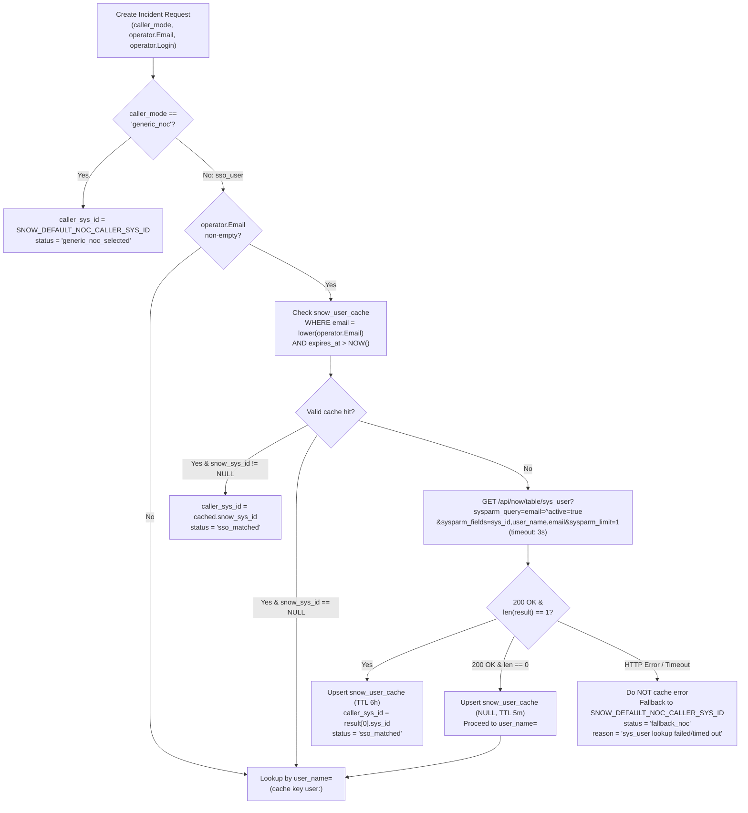

# 05 — ServiceNow Integration Specification

## 1. Purpose & Scope

This document specifies how the Go backend API integrates with **ServiceNow (SNOW)** via the **ServiceNow Table API** (`/api/now/table/...`) to support:
1. On-demand incident creation from an acknowledged alert in Grafana (modeled after the Grafana Cloud IRM ServiceNow workflow).
2. **SSO User Caller Attribution with Graceful Generic `noc` Fallback** (leveraging the shared corporate SSO identity between Grafana Generic OAuth and ServiceNow `sys_user`).
3. Idempotent ticket creation (`correlation_id`) preventing duplicate incidents on retries or timeouts.
4. **Bi-directional State & Link-Back Tracking** (ServiceNow Business Rule inbound webhook + background reconciler poller) to detect **alert-resolved / ticket-still-open drift (`resolved_open_ticket`)** and **alert-firing / ticket-closed drift (`active_closed_ticket`)**.
5. Environment-variable-only secret management and least-privilege ServiceNow service account permissions.

---

## 2. ServiceNow Authentication & Secret Handling

### 2.1 Transport Authentication Modes

All credentials are supplied strictly via environment variables (injected at runtime from Kubernetes Secrets, Vault, or AWS/GCP Secret Manager). **No credentials are ever stored in code, config files, or Grafana `jsonData`.**

#### Primary Mode: OAuth 2.0 Client Credentials (`SNOW_AUTH_MODE=oauth_client_credentials`)
- The Go API requests a bearer access token from `SNOW_TOKEN_URL` (typically `https://<instance>.service-now.com/oauth_token.do`) using `grant_type=client_credentials` with `SNOW_CLIENT_ID` and `SNOW_CLIENT_SECRET` (and optional `SNOW_OAUTH_SCOPE`).
- Tokens are cached in memory by the Go HTTP client and proactively refreshed `60 seconds` before `expires_in` (guarded by `singleflight` so concurrent requests trigger only one token refresh).
- On `401 Unauthorized` from ServiceNow, the client invalidates the cached token once, refreshes, and retries the request once.

#### Fallback Mode: Dedicated Service Account Basic Auth (`SNOW_AUTH_MODE=basic`)
- Uses HTTP Basic Auth with `SNOW_USERNAME` and `SNOW_PASSWORD` for a dedicated, non-interactive ServiceNow integration user (e.g., `svc_grafana_noc`).
- Mirrors the Grafana Cloud IRM recommendation: **never use a ServiceNow `admin` account**; assign only least-privilege roles.

### 2.2 Required ServiceNow Service Account Roles
- `itil` (standard role granting create/read/update on `incident` table and `work_notes`) — or a custom scoped ACL granting `create`/`read`/`write` on `incident` and `read` on `sys_user` and `sys_user_group`.
- `rest_service` / `web_service_admin` *(instance-dependent — verify whether your ServiceNow instance restricts Table API access via the `snc_platform_rest_api_access` role `[UNVERIFIED]`)*.

### 2.3 Environment Variable Reference (Placeholders Only)

| Environment Variable | Required | Default | Description |
|---|---|---|---|
| `SNOW_INSTANCE_URL` | Yes | — | Base URL of ServiceNow instance (e.g., `https://${SNOW_INSTANCE}.service-now.com`). |
| `SNOW_AUTH_MODE` | No | `oauth_client_credentials` | `oauth_client_credentials` or `basic`. |
| `SNOW_TOKEN_URL` | If OAuth | `${SNOW_INSTANCE_URL}/oauth_token.do` | OAuth 2.0 token endpoint. |
| `SNOW_CLIENT_ID` | If OAuth | — | OAuth Application Registry client ID. |
| `SNOW_CLIENT_SECRET` | If OAuth | — | OAuth Application Registry client secret. |
| `SNOW_OAUTH_SCOPE` | No | `""` | Optional OAuth scope string. |
| `SNOW_USERNAME` | If Basic | — | Dedicated service account username. |
| `SNOW_PASSWORD` | If Basic | — | Dedicated service account password. |
| `SNOW_DEFAULT_NOC_CALLER_SYS_ID` | Yes | — | ServiceNow `sys_user.sys_id` for the generic `noc` fallback user. |
| `SNOW_DEFAULT_NOC_CALLER_USERNAME` | No | `noc` | Display/fallback username for logs and UI labels. |
| `SNOW_DEFAULT_ASSIGNMENT_GROUP` | No | `""` | Fallback `assignment_group` name or `sys_id` when alert labels do not specify one. |
| `SNOW_DEFAULT_CATEGORY` | No | `Infrastructure` | Default `incident.category` choice value (`[UNVERIFIED]` — confirm choice list on target instance). |
| `SNOW_INBOUND_WEBHOOK_SECRET` | If push sync / BR | — | Shared secret (`X-SNOW-Signature-256` HMAC-SHA256 or Bearer token) authenticating `POST /api/v1/webhooks/servicenow` and `GET /api/v1/integrations/servicenow/incidents/{snow_sys_id}/active-status`. |
| `SNOW_HTTP_TIMEOUT_SECONDS` | No | `15` | Per-request HTTP timeout to ServiceNow Table API. |
| `SNOW_POLL_INTERVAL_SECONDS` | No | `120` | Background poller interval for syncing open linked incidents (`snow_state IN (1, 2, 3)`). |
| `SNOW_AUTO_REOPEN_COOLDOWN_SECONDS` | No | `300` | Per-incident cooldown window before re-attempting auto-reopen when a ticket moves to `6 (Resolved)` while alerts remain active. |
| `SNOW_AUTO_REOPEN_MAX_ATTEMPTS` | No | `3` | Maximum automatic reopens (`6 → 2`) allowed per linked incident before leaving `snow_state = 6` and surfacing the UI warning badge. |
| `SNOW_AUTO_POST_RESOLVED_NOTE` | No | `true` | If `true`, posts an informational work note to ServiceNow when a linked alert resolves while the ticket is still open. |
| `SNOW_NOTE_WORKER_INTERVAL_SECONDS` | No | `15` | Background interval for scanning resolved alerts needing an automatic ServiceNow resolution work note. |

---

## 3. SSO Caller Attribution & Generic `noc` Fallback

Because Grafana uses **Generic OAuth** against the same corporate SSO Identity Provider as ServiceNow, NOC operators can attribute created tickets to their personal SSO user with automatic, non-blocking fallback to the generic `noc` user.

### 3.1 Why Service-Account Transport + `sys_user` Lookup (Instead of Forwarding User OAuth Tokens)
1. Grafana App Plugins (`type: "app"`) do **not** have a native `oauthPassThru` toggle like Data Source plugins; Grafana keeps the user's raw IdP OAuth access token inside its core session store.
2. Even when forwarding an external OIDC token to ServiceNow (which requires registering the corporate IdP under *System OAuth → Application Registry → Configure an OIDC provider to verify ID tokens*), individual NOC operators frequently lack direct ServiceNow Table API write ACLs or may be logged in under a shared account — causing ticket creation to fail mid-outage.
3. By authenticating the HTTP transport with the dedicated service account and resolving `caller_id` via `sys_user` lookup from the operator's verified SSO email (`PluginContext.User.Email`), **ticket creation never fails due to per-user ACL gaps**, while still cleanly attributing the incident to the operator's SSO user whenever matched!

### 3.2 Caller Resolution Algorithm



- **Login (`user_name`) Fallback:** If `operator.Email` is empty OR email lookup finds no active `sys_user` (definite miss), `CallerResolver` automatically falls back to `LookupUserByUsername(operator.Login)` (cached in `snow_user_cache` under `user:<login>`) before falling back to `SNOW_DEFAULT_NOC_CALLER_SYS_ID`.
- **Secondary Safety Net:** If `POST /api/now/table/incident` with the matched `caller_sys_id` is rejected by a ServiceNow Business Rule/ACL with `400`/`403` referencing `caller_id`, the client retries **once** with `SNOW_DEFAULT_NOC_CALLER_SYS_ID`, sets `caller_resolution_status = 'fallback_noc'`, and appends the operator's SSO identity to `work_notes`.
- **Auditability:** Regardless of whether `sso_matched`, `generic_noc_selected`, or `fallback_noc` is used, `work_notes` always records `[Grafana NOC] Initiated in Grafana by: <Name> (<Login>, <Email>).` (omitting empty fields cleanly).
- **Note on `opened_by` vs `caller_id`:** By default, ServiceNow sets `opened_by` to the authenticated API service account unless an instance ACL/script permits overriding `opened_by` (`[UNVERIFIED]` — confirm on target ServiceNow instance whether `opened_by` is writable by the service account; this design sets `caller_id` unconditionally and treats overriding `opened_by` as optional).

---

## 4. ServiceNow Table API Contracts & Field Mapping

### 4.1 Create Incident (`POST /api/now/table/incident`)

**Request URL:**
```http
POST ${SNOW_INSTANCE_URL}/api/now/table/incident?sysparm_fields=sys_id,number,state,impact,urgency,priority,assignment_group,caller_id,opened_at,sys_updated_on&sysparm_display_value=all&sysparm_input_display_value=true
Authorization: Bearer <access_token>
Accept: application/json
Content-Type: application/json
```

**Request Body:**
```json
{
  "short_description": "[CRITICAL] HighDatabaseReplicationLag: Replication lag > 30s on orders-db-replica-2",
  "description": "Grafana NOC Alert Details\n-------------------------\nAlert Name: HighDatabaseReplicationLag\nSeverity: critical\nStarts At: 2026-11-25T16:10:00Z\nFingerprint: 1a2b3c4d5e6f7a8b\nGrafana Link: https://grafana.corp.example/a/noc-alert-manager-app/alerts/c7a2d5e8-9f31-4b2c-8a11-7e5f2c4d9a01\nPrometheus Query: https://prometheus.internal.example.com/graph?g0.expr=...\nRunbook: https://runbooks.internal.example.com/db-lag\n\nLabels:\n- cluster: prod-eu1\n- instance: orders-db-replica-2:9187\n- service: orders-db\n- severity: critical",
  "impact": "1",
  "urgency": "1",
  "assignment_group": "Database SRE",
  "category": "Database",
  "caller_id": "<resolved_sys_id_or_SNOW_DEFAULT_NOC_CALLER_SYS_ID>",
  "correlation_id": "c7a2d5e8-9f31-4b2c-8a11-7e5f2c4d9a01",
  "correlation_display": "Grafana NOC Alert Manager",
  "contact_type": "monitoring",
  "work_notes": "[Grafana NOC] Incident created by Alice Smith (alice.smith@corp.example). Acknowledged at 2026-11-25T16:12:15Z."
}
```

### 4.2 Alert-to-ServiceNow Field Mapping Table

| ServiceNow `incident` Field | Source / Transformation | Notes |
|---|---|---|
| `short_description` | Operator-edited modal input; default `"[<UPPER(severity)>] <alert_name>: <annotations.summary>"`, truncated to 160 chars. | Required by OOB ServiceNow incident table. |
| `description` | Operator-edited modal input; default structured summary of alert timestamps, labels, annotations, `generator_url`, `runbook_url`, and Grafana deep link. | Gives responders full context without switching tools. |
| `impact` | `"1"` (High), `"2"` (Medium), `"3"` (Low). Default derived from `alerts.severity` (`critical`→`1`, `warning`→`2`, `info`/`unknown`→`3`). | OOB ServiceNow choice integers (serialized as strings or ints). |
| `urgency` | `"1"` (High), `"2"` (Medium), `"3"` (Low). Default matches `impact`. | ServiceNow Data Lookup Rules auto-calculate read-only `priority` (`1`–`5`). |
| `assignment_group` | Operator-selected group; pre-selected from learned `team_assignment_group_mappings[labels["team"]]` (only when Prometheus `labels["team"]` is mapped — never blindly copied) → `labels["assignment_group"]` → `SNOW_DEFAULT_ASSIGNMENT_GROUP`. | Accepts group `sys_id` or exact display name (sent with `sysparm_input_display_value=true`). Creating an incident for alert(s) sharing a non-empty Prometheus `labels["team"]` persists the learned mapping in PostgreSQL. |
| `category` | Operator-selected category; default `SNOW_DEFAULT_CATEGORY`. | `[UNVERIFIED]` — confirm exact valid choice values in target SNOW instance (`sys_choice` table for `incident.category`). |
| `caller_id` | Resolved `sys_user.sys_id` (from SSO email) or `SNOW_DEFAULT_NOC_CALLER_SYS_ID`. | Always populated with a valid `sys_id`. |
| `correlation_id` | `alerts.id` for single-alert creation, or `PrimaryAlertID` (lexicographically smallest selected alert UUID) for bulk creation. | Primary idempotency & deduplication key in ServiceNow. |
| `correlation_display` | Static `"Grafana NOC Alert Manager"`. | Identifies the originating integration in ServiceNow UI. |
| `contact_type` | Static `"monitoring"` (or `"event"` — `[UNVERIFIED]` confirm allowed `contact_type` choice value on target SNOW instance). | Optional; omit if restricted by instance choice policy. |
| `work_notes` | Operator note + Grafana operator identity + fallback explanation (if `fallback_noc`). | Written to internal Activity Stream (not customer-visible `comments`). |

### 4.3 Verified ServiceNow Response Parsing (`201 Created` / `200 OK`)

```json
{
  "result": {
    "sys_id": { "display_value": "51615243c0a801640139e875df691a31", "value": "51615243c0a801640139e875df691a31" },
    "number": { "display_value": "INC0012345", "value": "INC0012345" },
    "state": { "display_value": "New", "value": "1" },
    "priority": { "display_value": "1 - Critical", "value": "1" },
    "assignment_group": { "display_value": "Database SRE", "value": "d625dccec0a8016700a222a0f7900d06" },
    "opened_at": { "display_value": "2026-11-25 16:13:04", "value": "2026-11-25 16:13:04" }
  }
}
```

- **Deep Link Construction:** `${SNOW_INSTANCE_URL}/nav_to.do?uri=incident.do?sys_id=${result.sys_id.value}`.
- **OOB ServiceNow State Mapping:**

| `snow_state` (DB Value) | `snow_state_label` | Considered Open in Drift Detection? |
|---|---|---|
| `1` | `New` | **Yes (Open)** |
| `2` | `In Progress` | **Yes (Open)** |
| `3` | `On Hold` | **Yes (Open)** |
| `6` | `Resolved` | No (Terminal/Resolved) |
| `7` | `Closed` | No (Terminal/Closed) |
| `8` | `Canceled` | No (Terminal/Canceled) |

*(Note: `[UNVERIFIED]` — If your ServiceNow instance has customized incident state integers beyond OOB values 1/2/3/6/7/8, update the state map and DB `CHECK` constraint accordingly.)*

---

### 4.4 Idempotency Recovery Before Retrying a Timed-Out Creation

If an initial `POST /api/now/table/incident` times out at the Go HTTP client (`504 Gateway Timeout`), ServiceNow may still have committed the record. Before issuing a retry `POST`, the Go API executes:

```http
GET ${SNOW_INSTANCE_URL}/api/now/table/incident?sysparm_query=correlation_id=${alert_id}&sysparm_fields=sys_id,number,state,priority,assignment_group,opened_at&sysparm_display_value=all&sysparm_limit=1
```

- If a record is returned → adopt it (`sync_status = 'created'`, store `sys_id` and `number`) without creating a duplicate ticket!
- If empty → safely issue `POST /api/now/table/incident`.

---

### 4.5 Updating Work Notes (`PATCH /api/now/table/incident/{sys_id}`)

Used for both manual NOC nudges (`POST /api/v1/alerts/{id}/servicenow/work-notes`) and optional automated resolution notes (`SNOW_AUTO_POST_RESOLVED_NOTE=true`):

```http
PATCH ${SNOW_INSTANCE_URL}/api/now/table/incident/${snow_sys_id}
Authorization: Bearer <access_token>
Content-Type: application/json

{
  "work_notes": "[Grafana NOC] Prometheus Alertmanager reported alert HighDatabaseReplicationLag RESOLVED at 2026-11-25T16:52:00Z. This incident is still open in ServiceNow — please verify recovery and resolve/close the ticket."
}
```

> **Important Policy Decision:** When an alert stops firing (`alerts.state = 'resolved'`), the Go API **does NOT automatically close or resolve the ServiceNow incident**. Instead, it posts an informational work note (if `SNOW_AUTO_POST_RESOLVED_NOTE=true`) and flags the episode under **`Resolved — Open Ticket`** (`incident_drift_status = "resolved_open_ticket"`) so the NOC and owning engineering team have explicit visibility that the alert cleared while the ticket remains unresolved.

---

### 4.6 Bulk Multi-Alert Incident Creation & Linking (`POST /api/v1/servicenow/incidents/bulk`)

Operators can select between `1` and `50` alerts (`firing` or `acknowledged`, without an existing active/pending incident) and open a single ServiceNow incident covering all of them:

1. **Phase 1 — Deterministic Reservation & Auto-Ack (`ReserveBulkIncidentCreation`):**
   - Claims `Idempotency-Key` in `idempotency_keys` (if supplied), deduplicates and sorts `alert_ids` lexicographically, and sets `PrimaryAlertID = sortedIDs[0]`.
   - Locks all selected `alerts` in `ORDER BY id ASC FOR UPDATE`. Rejects missing alerts (`404`) or alerts not in `firing`/`acknowledged` (`409 INVALID_STATE_TRANSITION`).
   - If any selected alert is `firing`, verifies `noc-alert-manager-app.alerts:triage` (`403 FORBIDDEN_RBAC` if absent) and auto-acknowledges it inside Tx 1 (`state = 'acknowledged'`, `version += 1`, `alert_acknowledged` audit event with `auto_acknowledged_by_incident: true`).
   - Locks existing `servicenow_incidents` rows (`ORDER BY alert_id ASC FOR UPDATE`), rejecting if any alert is already `created`/`linked` (`409 INCIDENT_ALREADY_LINKED`) or non-stale `pending` (`409 INCIDENT_CREATION_IN_PROGRESS`).
   - Collects all candidate correlation IDs across every alert with a prior `failed` or stale `pending` row (including `a.ID` and prior `snow_correlation_id` values from `alert_audit_log`), reserves/updates `pending` rows in `servicenow_incidents`, and logs `snow_incident_requested` (including `"snow_correlation_id": PrimaryAlertID`), then commits Tx 1.
2. **Phase 2 — Single Outbound ServiceNow Creation (`CreateBulkIncident`):**
   - Resolves caller via `CallerResolver` (SSO + `noc` fallback).
   - If any alert in the batch had a prior `failed` or stale `pending` row, checks `FindIncidentByCorrelationID` across every candidate correlation ID before issuing `POST /api/now/table/incident` with `correlation_id = PrimaryAlertID` and a combined description listing every included alert (`formatBulkDefaultDescription`).
   - Applies the same one-time `caller_id` rejection fallback to `SNOW_DEFAULT_NOC_CALLER_SYS_ID`.
3. **Phase 3 — Bulk Finalization (`FinalizeBulkIncidentCreated` / `FinalizeBulkIncidentFailed`):**
   - Locks `idempotency_keys` then all selected `alerts` in `ORDER BY id ASC FOR UPDATE`.
   - On success, updates the primary alert's `servicenow_incidents` row to `sync_status = 'created'` (`snow_incident_created`) and all sibling alerts' rows to `sync_status = 'linked'` (`snow_incident_linked`), all pointing to the same `snow_sys_id`, `incident_number`, and `incident_url`, and persists the `201` response in `idempotency_keys`.
   - On failure, marks every reserved row `sync_status = 'failed'` (`snow_incident_failed`) and releases any `in_progress` idempotency claim while keeping all alerts `acknowledged` for safe retry.
4. **Sibling-Aware Sync & Resolution Notes:**
   - Manual `/sync` (`UpdateIncidentForAlert`) acquires canonical row locks across all sibling `alerts` (`ORDER BY id ASC FOR UPDATE OF a`) and `servicenow_incidents` (`ORDER BY alert_id ASC FOR UPDATE`) sharing `snow_sys_id` and records `snow_state_synced` audit rows for every updated sibling.
   - The resolution-note worker checks remaining active siblings on `snow_sys_id`: while any sibling remains `firing`/`acknowledged`, it posts a partial-recovery progress note instructing ServiceNow to keep the ticket open; once all linked alerts resolve, it posts a consolidated recovery/closure nudge and stamps `resolution_note_posted_at` across all resolved pending rows.

---

## 5. Bi-Directional & Link-Back State Synchronization

To guarantee the NOC console always knows whether the engineering team has resolved a ServiceNow ticket — especially after an alert stops firing — the design combines **real-time push (webhook)** with a **self-healing background poller**.

### 5.1 Push Channel: ServiceNow Inbound Webhook (`POST /api/v1/webhooks/servicenow`)

Configure an asynchronous **ServiceNow Business Rule** (after update on `incident` when `correlation_display == 'Grafana NOC Alert Manager'` OR `correlation_id IS NOT EMPTY`, triggering when `state` changes):
- **Auth:** Computes `HMAC-SHA256(raw_body, SNOW_INBOUND_WEBHOOK_SECRET)` sent in `X-SNOW-Signature-256: sha256=<hex>`.
- **Inbound Payload Contract:**
```json
{
  "sys_id": "51615243c0a801640139e875df691a31",
  "number": "INC0012345",
  "correlation_id": "c7a2d5e8-9f31-4b2c-8a11-7e5f2c4d9a01",
  "state": 6,
  "state_label": "Resolved",
  "priority": 1,
  "assignment_group": "Database SRE",
  "updated_by": "jane.dba",
  "resolved_at": "2026-11-25T17:10:00Z",
  "closed_at": null,
  "close_notes": "Caught up replica WAL lag after index rebuild completed."
}
```
- **Go API Processing:**
  1. Verifies HMAC signature with `hmac.Equal`.
  2. Locks all linked `alerts` (`ORDER BY a.id ASC FOR UPDATE OF a`) and then all `servicenow_incidents` matching `snow_sys_id = $1` (`ORDER BY s.alert_id ASC FOR UPDATE`), atomically updating newly created, manually linked, and bulk-linked sibling alerts.
  3. Updates `snow_state`, `snow_state_label`, `priority`, `assignment_group`, `snow_resolved_at`, `snow_closed_at`, `snow_state_synced_at = NOW()`.
  4. Inserts `snow_state_synced` into `alert_audit_log` (recording previous → new SNOW state and `updated_by` / `close_notes`).
  5. **Drift Reconciliation:**
     - If `alerts.state == 'resolved'` and `snow_state IN (6, 7, 8)` → drift clears automatically (`resolved_open_ticket` → `none`)!
     - If `alerts.state IN ('firing', 'acknowledged')` and `snow_state IN (6, 7, 8)` → surfaces `incident_drift_status = "active_closed_ticket"` in the NOC UI (warning that the ticket was closed while the alert is still active; does **not** forcibly resolve the Prometheus alert).

### 5.2 Pull Channel: Background Reconciler Poller (Self-Healing Guarantee)

ServiceNow Business Rules can be skipped, misconfigured, or fail during transient network blips. Therefore, a lightweight background goroutine in the Go API runs every `SNOW_POLL_INTERVAL_SECONDS` (default `120s`, using a PostgreSQL advisory lock `pg_try_advisory_lock` so only one API replica polls at a time):
1. Queries up to `50` oldest-synced open tickets using `idx_snow_incidents_open_sync`:
   ```sql
   SELECT DISTINCT ON (snow_sys_id) snow_sys_id
   FROM servicenow_incidents
   WHERE sync_status IN ('created', 'linked')
     AND snow_state IN (1, 2, 3)
     AND snow_sys_id IS NOT NULL
   ORDER BY snow_sys_id, snow_state_synced_at ASC NULLS FIRST
   LIMIT 50;
   ```
2. Fetches them in a **single batched Table API request**:
   ```http
   GET ${SNOW_INSTANCE_URL}/api/now/table/incident?sysparm_query=sys_idIN<id1,id2,...>&sysparm_fields=sys_id,number,state,priority,assignment_group,resolved_at,closed_at,sys_updated_on&sysparm_display_value=all
   ```
3. Updates `servicenow_incidents` rows and appends `snow_state_synced` audit events only when `snow_state` or `assignment_group` actually changed.
4. Updates Prometheus gauge `noc_alerts_resolved_with_open_snow_incident` so NOC leads can even alert on stale unclosed tickets!

### 5.3 Preventing Premature Ticket Closure While Alerts Are Active

Three complementary safeguards protect against resolving or closing ServiceNow incidents while linked Prometheus alerts are still firing/acknowledged:

1. **Before-Update ServiceNow Business Rule (Checked-In Artifact Only):**
   - [`docs/servicenow/prevent-close-active-alert-br.js`](../servicenow/prevent-close-active-alert-br.js) is a ready-to-deploy `before` update Business Rule on `incident` (scoped to `correlation_display == 'Grafana NOC Alert Manager'` when `state` changes to `6` or `7`).
   - Calls `GET /api/v1/integrations/servicenow/incidents/{snow_sys_id}/active-status` authenticated with `Authorization: Bearer <SNOW_INBOUND_WEBHOOK_SECRET>` (from ServiceNow System Property `x_grafana_noc.webhook_secret`) with a `3000ms` timeout.
   - Fails **open** on timeout/5xx/missing property and supports an `admin` / `x_grafana_noc.override_role` escape hatch so engineers are never locked out during API outages.
   - Calls `current.setAbortAction(true)` + `gs.addErrorMessage(...)` when `has_active_alerts === true`.
2. **Backend Auto-Reopen Safety Net (`6 → 2`):**
   - Whenever the inbound webhook or drift poller detects a linked incident transitioned to `6 (Resolved)` while one or more linked alerts remain `firing` or `acknowledged`, the Go API PATCHes `incident` back to `2 (In Progress)` with an attributed `[Grafana NOC] Auto-reopened: ...` work note and records `snow_incident_reopened` audit events.
   - Enforces per-incident concurrency serialization, a configurable cooldown (`SNOW_AUTO_REOPEN_COOLDOWN_SECONDS`, default `300s`), and an attempt cap (`SNOW_AUTO_REOPEN_MAX_ATTEMPTS`, default `3`) to prevent infinite reopen loops. Tickets in `7 (Closed)` or `8 (Canceled)` are never auto-reopened.
3. **Grafana Closed-Ticket Warning Fallback:**
   - When a ticket moves to `7 (Closed)` / `8 (Canceled)` or auto-reopen is skipped/fails while an alert remains active, `GET /api/v1/alerts` surfaces `summary.active_closed_ticket > 0` and the **Acknowledged** KPI card displays a red warning badge visible from the default **Firing** view.

---

## 6. Resilience, Rate Limiting & Circuit Breaking

- **Circuit Breaker:** If ServiceNow returns `>= 5` consecutive `5xx`/timeout errors within `60s`, the outbound SNOW client opens its circuit breaker for `30s` (half-open probe after `30s`), returning immediate `503 SNOW_UNAVAILABLE` to UI creation calls and pausing the background poller — protecting both ServiceNow and Go API worker threads.
- **Per-Request Timeouts:** `3s` for `sys_user` SSO lookups (fast fallback to `noc`), `15s` (`SNOW_HTTP_TIMEOUT_SECONDS`) for `POST/PATCH/GET` incident calls.
- **No Unbounded Retries on `POST`:** Automatic retries apply only to idempotent `GET` calls and `401` token refreshes; `POST` creation failures return an error to the operator with a safe manual **Retry** button (which runs the `correlation_id` pre-check first).
