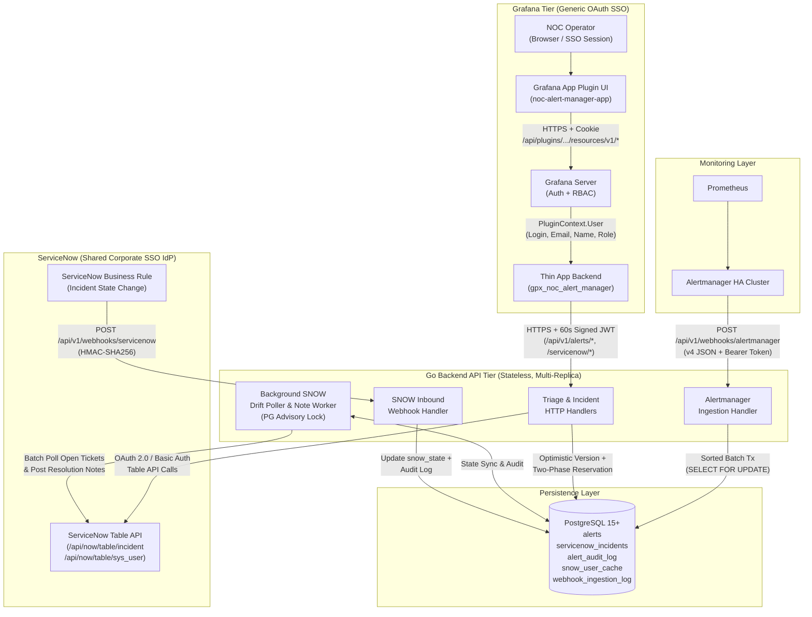

# Master Low-Level Design (LLD): NOC Alert-Management System

## 1. Executive Summary

This master Low-Level Design (LLD) unifies the five component specifications for the **NOC Alert-Management System** — an end-to-end platform enabling Network Operations Center (NOC) teams to ingest Prometheus Alertmanager alerts, manage alert lifecycle state in PostgreSQL, triage incidents inside Grafana, create and track ServiceNow incidents (with corporate SSO attribution and generic `noc` fallback), and detect alert-to-ticket state drift (such as alerts that stopped firing while their ServiceNow ticket remains open).

### Component Specification Index

| # | Document | Core Responsibility |
|---|---|---|
| 1 | [01-grafana-plugin.md](01-grafana-plugin.md) | Grafana App Plugin (`noc-alert-manager-app`), App vs. Panel trade-off, `CallResource` SSO proxy, NOC queue & Action Bar UX. |
| 2 | [02-go-api-service.md](02-go-api-service.md) | Standalone Go HTTP API contracts, internal JWT/RBAC verification, row locking & two-phase SNOW reservation. |
| 3 | [03-postgres-schema.md](03-postgres-schema.md) | PostgreSQL DDL, `(fingerprint, starts_at)` episode identity, partial unique active-episode index, audit log, SSO user cache. |
| 4 | [04-alertmanager-ingestion.md](04-alertmanager-ingestion.md) | Alertmanager v4 webhook contract, reconciliation algorithm, re-firing semantics, retry/backoff status codes. |
| 5 | [05-servicenow-integration.md](05-servicenow-integration.md) | ServiceNow Table API mapping, SSO `sys_user` lookup + `noc` fallback, `correlation_id` idempotency, push + poll bi-directional sync. |

---

## 2. System Architecture



---

## 3. End-to-End Sequence Diagrams

### 3.1 Flow 1: Alert Firing → NOC Acknowledge → Create ServiceNow Incident (SSO + `noc` Fallback)

```mermaid
sequenceDiagram
    autonumber
    participant AM as Alertmanager
    participant API as Go Backend API
    participant PG as PostgreSQL
    participant UI as Grafana App Plugin
    participant GF as Grafana + CallResource
    participant SNOW as ServiceNow Table API

    AM->>API: POST /api/v1/webhooks/alertmanager (status=firing, fingerprint=fp1, startsAt=T1)
    API->>PG: BEGIN; INSERT alerts (id=A1, state=firing, version=1) + INSERT alert_audit_log; COMMIT
    API-->>AM: 200 OK

    UI->>GF: GET /resources/v1/alerts?state=firing (poll)
    GF->>API: GET /api/v1/alerts (Signed JWT: alice.smith@corp.example, Editor)
    API->>PG: SELECT alerts + servicenow_incidents + summary counts
    API-->>UI: 200 OK (Alert A1, state=firing, version=1)

    Note over UI: NOC operator clicks [Acknowledge]
    UI->>GF: POST /resources/v1/alerts/A1/acknowledge {version: 1}
    GF->>API: POST /api/v1/alerts/A1/acknowledge (JWT: alice.smith)
    API->>PG: BEGIN; SELECT A1 FOR UPDATE; UPDATE state=acknowledged, version=2; INSERT audit_log; COMMIT
    API-->>UI: 200 OK (state=acknowledged, version=2)
    Note over UI: Contextual Action Bar appears with [Create ServiceNow Incident]

    Note over UI: Operator submits Create SNOW Incident modal (caller_mode="sso_user")
    UI->>GF: POST /resources/v1/alerts/A1/servicenow/incident (Idempotency-Key: K1)
    GF->>API: POST /api/v1/alerts/A1/servicenow/incident (JWT: alice.smith@corp.example)

    API->>PG: Tx1: Lock A1 (check acknowledged); INSERT servicenow_incidents (sync_status=pending, correlation_id=A1); COMMIT
    API->>PG: Check snow_user_cache for alice.smith@corp.example
    alt Cache Miss
        API->>SNOW: GET /api/now/table/sys_user?sysparm_query=email=alice.smith@corp.example^active=true (3s timeout)
        alt Active SSO User Found
            SNOW-->>API: 200 OK (sys_id=U_ALICE)
            API->>PG: Cache U_ALICE (TTL 6h)
        else Not Found or Timeout
            SNOW-->>API: 200 OK [] / Error
            Note over API: Graceful fallback to SNOW_DEFAULT_NOC_CALLER_SYS_ID (status=fallback_noc)
        end
    end

    API->>SNOW: POST /api/now/table/incident (correlation_id=A1, caller_id=U_ALICE or U_NOC)
    SNOW-->>API: 201 Created (sys_id=S1, number=INC0012345, state=1 New)

    API->>PG: Tx2: UPDATE servicenow_incidents (sync_status=created, INC0012345, snow_state=1); INSERT audit_log; COMMIT
    API-->>UI: 201 Created (INC0012345 + optional fallback warning banner)
```

---

### 3.2 Flow 2: Alert Stops Firing While ServiceNow Ticket Remains Open (Drift Detection & Sync)

```mermaid
sequenceDiagram
    autonumber
    participant AM as Alertmanager
    participant API as Go Backend API
    participant PG as PostgreSQL
    participant SNOW as ServiceNow
    participant UI as Grafana App Plugin

    Note over PG: Alert A1 is acknowledged; INC0012345 is In Progress (snow_state=2)
    AM->>API: POST /api/v1/webhooks/alertmanager (status=resolved, fp1, startsAt=T1, endsAt=T2)
    API->>PG: BEGIN; Lock A1; UPDATE state=resolved, ends_at=T2, resolved_at=T2, version=3; INSERT audit_log; COMMIT
    API-->>AM: 200 OK (fast <100ms, decoupled from SNOW)

    Note over API,SNOW: Async background worker checks SNOW_AUTO_POST_RESOLVED_NOTE
    API->>SNOW: PATCH /api/now/table/incident/S1 {work_notes: "Alert resolved at T2; ticket still open"}
    SNOW-->>API: 200 OK
    API->>PG: UPDATE servicenow_incidents SET resolution_note_posted_at=NOW(); INSERT audit_log

    UI->>API: GET /api/v1/alerts?incident_drift=resolved_open_ticket
    API->>PG: Join alerts (state=resolved) + servicenow_incidents (snow_state IN 1,2,3)
    API-->>UI: 200 OK (A1 flagged: "Alert Resolved · Ticket Still Open")

    Note over SNOW: Owning team later verifies fix and resolves INC0012345 (state=6)
    alt Real-Time Push (Business Rule Webhook)
        SNOW->>API: POST /api/v1/webhooks/servicenow (HMAC-SHA256, sys_id=S1, state=6)
        API->>PG: UPDATE servicenow_incidents SET snow_state=6, snow_resolved_at=...; INSERT audit_log
        API-->>SNOW: 200 OK
    else Fallback Background Poller (every 120s)
        API->>SNOW: GET /api/now/table/incident?sysparm_query=sys_idINS1,...
        SNOW-->>API: 200 OK (S1 state=6 Resolved)
        API->>PG: UPDATE servicenow_incidents SET snow_state=6; INSERT audit_log
    end

    Note over UI: Next poll clears A1 from "Resolved — Open Ticket" drift filter
```

---

### 3.3 Flow 3: Alert Re-Firing After Resolution (Fresh Unacknowledged Episode)

```mermaid
sequenceDiagram
    autonumber
    participant AM as Alertmanager
    participant API as Go Backend API
    participant PG as PostgreSQL
    participant UI as Grafana App Plugin

    Note over PG: Episode 1 (id=A1, fp1, startsAt=T1) is state=resolved (uq_alerts_active_fingerprint released)
    AM->>API: POST /api/v1/webhooks/alertmanager (status=firing, fp1, startsAt=T3 > T1)
    API->>PG: SELECT (fp1, T3) -> none; SELECT active (fp1) -> none
    API->>PG: INSERT alerts (id=A2, fp1, startsAt=T3, state=firing, acknowledged_by=NULL, version=1) + audit_log
    API-->>AM: 200 OK

    UI->>API: GET /api/v1/alerts?state=firing
    API-->>UI: Returns A2 as brand-new UNACKNOWLEDGED firing alert (with previous_episode_count=1 linking history to A1 / INC0012345)
```

---

## 4. Unified Alert Lifecycle & State Transition Matrix

### 4.1 Alert State Transitions (`alerts.state`)

| Current State | Event / Action | Actor | Next State | Version Bump | Audit Event | Notes |
|---|---|---|---|---|---|---|
| *(none)* | AM webhook `firing` (new `fp, startsAt`) | Alertmanager | `firing` | `= 1` | `alert_fired` | Creates new episode row. |
| `firing` | AM webhook `firing` (same `fp, startsAt`) | Alertmanager | `firing` | No | `alert_updated` *(if changed)* | Refreshes labels/annotations/count. |
| `firing` | `POST /acknowledge` | Operator (Editor+) | `acknowledged` | `+1` | `alert_acknowledged` | Reveals SNOW Action Bar in UI. |
| `firing` | `POST /dismiss` | Operator (Editor+) | `dismissed` | `+1` | `alert_dismissed` | Requires `reason`. |
| `firing` | AM webhook `resolved` | Alertmanager | `resolved` | `+1` | `alert_resolved` | Auto-cleared without NOC ack. |
| `acknowledged` | AM webhook `firing` (same `fp, startsAt`) | Alertmanager | `acknowledged` | No | `alert_updated` *(if changed)* | Preserves ack & owner. |
| `acknowledged` | `POST /servicenow/incident` | Operator (Editor+) | `acknowledged` | No | `snow_incident_created` | Links SNOW ticket (`servicenow_incidents`). |
| `acknowledged` | `POST /unacknowledge` | Operator (Editor+) | `firing` | `+1` | `alert_unacknowledged` | Clears ack fields; keeps any linked SNOW ticket. |
| `acknowledged` | `POST /dismiss` | Operator (Editor+) | `dismissed` | `+1` | `alert_dismissed` | Requires `reason`. |
| `acknowledged` | AM webhook `resolved` | Alertmanager | `resolved` | `+1` | `alert_resolved` | Triggers `resolved_open_ticket` drift if SNOW state is `1/2/3`. |
| `dismissed` | AM webhook `firing` (same `fp, startsAt`) | Alertmanager | `dismissed` | No | *(none)* | Suppressed for current episode. |
| `dismissed` | `POST /reopen` | Operator (Editor+) | `firing` | `+1` | `alert_reopened` | Returns episode to active queue. |
| `dismissed` | AM webhook `resolved` | Alertmanager | `resolved` | `+1` | `alert_resolved` | Closes episode; releases active fingerprint. |
| `resolved` | AM webhook `firing` (**same** `startsAt`) | Alertmanager | `resolved` | No | *(none)* | Ignored (out-of-order delayed delivery). |
| `resolved` | AM webhook `firing` (**new** `startsAt`) | Alertmanager | *(new row)* `firing` | `= 1` | `alert_fired` | Fresh unacknowledged episode! |
| `resolved` | `POST /acknowledge` or `/dismiss` | Operator | *(409 Rejected)* | No | *(none)* | Terminal episode state. |

### 4.2 Cross-System Drift Matrix (`alerts.state` × `servicenow_incidents.snow_state`)

| `alerts.state` | Linked `snow_state` | `incident_drift_status` | Operational Meaning & UI Treatment |
|---|---|---|---|
| `firing` / `acknowledged` | *(none)* | `none` | Normal active alert (if `acknowledged`, show SNOW Action Bar). |
| `firing` / `acknowledged` | `1` (New), `2` (In Progress), `3` (On Hold) | `none` | Aligned — incident is actively being worked. |
| `firing` / `acknowledged` | `6` (Resolved), `7` (Closed), `8` (Canceled) | `active_closed_ticket` | **Red Drift Badge:** Team closed SNOW ticket while alert is still firing! |
| `resolved` | `1` (New), `2` (In Progress), `3` (On Hold) | `resolved_open_ticket` | **Amber Drift Badge:** Alert stopped firing, but team has not resolved the SNOW ticket! Highlighted in top KPI card & filter. |
| `resolved` | `6` (Resolved), `7` (Closed), `8` (Canceled) | `none` | Fully closed end-to-end. |
| `dismissed` | `1` / `2` / `3` | `none` *(informational badge)* | Alert dismissed in NOC; SNOW ticket link remains visible for manual follow-up. |

---

## 5. Failure Modes, Race Conditions & Mitigations

| # | Failure Mode / Edge Case | Concrete Impact Without Mitigation | Mitigation Strategy |
|---|---|---|---|
| 1 | **Race: Operator clicks `Acknowledge` at the exact millisecond Alertmanager sends `resolved`** | Lost update: alert stays stuck in `acknowledged` after resolution or operator overwrites `resolved_at`. | Both paths lock the row with `SELECT ... FOR UPDATE`. If webhook commits first (`version` bumps, `state='resolved'`), the operator's ack fails with `409 Conflict` carrying the fresh `resolved` snapshot. If operator commits first, webhook transitions `acknowledged` → `resolved` cleanly. |
| 2 | **Race: Two NOC operators click `Acknowledge` or `Create SNOW Incident` simultaneously** | Duplicate audit logs or two ServiceNow incidents created for the same alert. | `Acknowledge` is serialized by `FOR UPDATE` + optimistic `version` check (second operator gets `409` showing who acked). `Create SNOW Incident` enforces `UNIQUE (alert_id)` on `servicenow_incidents` in Tx 1; the second request immediately receives `409 INCIDENT_CREATION_IN_PROGRESS` or `409 INCIDENT_ALREADY_LINKED`. |
| 3 | **ServiceNow timeout (`504`) after ServiceNow actually created the incident** | Operator clicks Retry and creates a duplicate `INC` ticket. | `correlation_id = alert_id` is sent on every `POST`. Before retrying any `failed` or stale `pending` (>60s) record, the Go API queries `GET /api/now/table/incident?sysparm_query=correlation_id=<alert_id>` and adopts the existing ticket if found. |
| 4 | **ServiceNow API completely down / unreachable** | Alert triage stalls, DB connection pool exhausts, or Alertmanager webhooks time out. | (a) Two-phase reservation never holds DB transactions open across SNOW HTTP calls.<br>(b) Alertmanager webhooks never call SNOW synchronously.<br>(c) SNOW client circuit breaker fails fast (`503`) while `Acknowledge`/`Dismiss` and `/readyz` remain 100% healthy. |
| 5 | **Operator's Grafana SSO email does not exist or is inactive in ServiceNow `sys_user`** | Ticket creation fails during a critical outage. | 3-second bounded `sys_user` lookup with `snow_user_cache` automatically falls back to `SNOW_DEFAULT_NOC_CALLER_SYS_ID` (`generic_noc`), records `caller_resolution_status='fallback_noc'`, logs the operator's real SSO email in `work_notes` and `alert_audit_log`, and returns a non-blocking warning banner. |
| 6 | **Alertmanager HA duplicate delivery or batch deadlock** | Duplicate alert rows or PostgreSQL deadlock errors (`40P01`). | `UNIQUE (fingerprint, starts_at)` + deterministic sorting of `alerts[]` by `(fingerprint, startsAt)` prior to row locking eliminates deadlocks and guarantees idempotency. |
| 7 | **Missed Alertmanager `resolved` webhook followed by a later re-fire** | `uq_alerts_active_fingerprint` constraint violation blocks the new firing alert. | Reconciler detects an existing open episode with `active.starts_at < incoming.startsAt`, auto-resolves the superseded episode with an audit note, and inserts the new `firing` episode in the same transaction. |
| 8 | **Alertmanager `max_alerts` truncates alerts in a large storm** | Alerts silently dropped from PostgreSQL. | Recommend `max_alerts: 0`. If `truncatedAlerts > 0` ever arrives, record in `webhook_ingestion_log`, log `WARN`, and fire a meta-alert on `noc_alertmanager_truncated_alerts_total > 0`. |
| 9 | **ServiceNow Business Rule webhook fails or is dropped** | NOC console shows stale `resolved_open_ticket` forever after team closes the ticket. | Self-healing background poller runs every `SNOW_POLL_INTERVAL_SECONDS` (default 120s) to reconcile all open linked tickets (`snow_state IN (1, 2, 3)`), plus operators have a manual **Refresh SNOW Status** button. |
| 10 | **PostgreSQL brief outage or failover** | Alerts lost during DB restart. | Webhook handler returns `503 Service Unavailable`, triggering Alertmanager's built-in exponential backoff retries until PostgreSQL recovers; `/readyz` fails so load balancers stop routing traffic to unhealthy API replicas. |

---

## 6. Security, RBAC & Operational Readiness

### 6.1 End-to-End Security Controls
- **Zero Secrets in Frontend or Source:** ServiceNow OAuth/Basic credentials and PostgreSQL DSNs live solely in Go API environment variables (`SNOW_*`, `DATABASE_URL`). The Grafana plugin stores only the internal JWT signing secret (`apiJwtSecret`) encrypted inside Grafana `secureJsonData`.
- **Transport Encryption:** TLS 1.2+ mandatory for Browser ↔ Grafana, Grafana ↔ Go API, Alertmanager ↔ Go API, Go API ↔ PostgreSQL (`sslmode=require`), and Go API ↔ ServiceNow (`https://`).
- **Tamper-Proof Operator Attribution:** Operator identity (`login`, `email`, `role`, `permissions`) is extracted server-side from Grafana's authenticated `PluginContext.User` and cryptographically signed into a 60-second JWT (`HS256`); client-supplied JSON bodies cannot spoof actor identity.
- **Database Least Privilege:** Application DB user (`noc_api_app`) has `SELECT, INSERT` only on `alert_audit_log` (no `UPDATE`/`DELETE`), preventing audit log tampering even if an application bug occurs.
- **Webhook Hardening:** Constant-time token/HMAC verification (`subtle.ConstantTimeCompare` / `hmac.Equal`), strict `5 MiB` body cap (`http.MaxBytesReader`), and strict JSON schema validation.

### 6.2 RBAC Authorization Matrix

| Capability | Grafana Plugin RBAC Action | Default Grant (OSS & Enterprise) | Go API Enforcement |
|---|---|---|---|
| View alert queue, details, audit history, past episodes, SNOW metadata | `noc-alert-manager-app.alerts:read` | `Viewer`, `Editor`, `Admin` | Verified via signed JWT `permissions` / `role`. |
| Acknowledge, unacknowledge, dismiss, reopen, add triage notes | `noc-alert-manager-app.alerts:triage` | `Editor`, `Admin` | Verified via signed JWT `permissions` / `role`. |
| Create/link SNOW incident, post SNOW work note, force SNOW sync | `noc-alert-manager-app.incidents:write` | `Editor`, `Admin` | Verified via signed JWT `permissions` / `role`. |
| Configure Grafana plugin URL, poll interval, JWT secret | `noc-alert-manager-app.settings:write` | `Admin` | Enforced by Grafana App Settings API. |
| Ingest Alertmanager alerts | *(N/A — Machine Auth)* | Alertmanager Receiver | `ALERTMANAGER_WEBHOOK_TOKEN` Bearer auth. |
| Push ServiceNow incident state changes | *(N/A — Machine Auth)* | ServiceNow Business Rule | `SNOW_INBOUND_WEBHOOK_SECRET` HMAC-SHA256. |

### 6.3 Observability: Metrics, Logging & Health Probes

#### Prometheus Metrics (`/metrics` on `ADMIN_PORT`)
- `noc_http_requests_total{method, route, status}` (Counter) & `noc_http_request_duration_seconds{method, route}` (Histogram)
- `noc_alertmanager_webhooks_total{status}` (Counter) & `noc_alertmanager_alerts_processed_total{action="inserted|updated|resolved|ignored"}` (Counter)
- `noc_alertmanager_truncated_alerts_total` (Counter — alert if `> 0`)
- `noc_alerts_state_current{state="firing|acknowledged|dismissed"}` (Gauge)
- `noc_alerts_resolved_with_open_snow_incident` (Gauge — tracks `resolved_open_ticket` backlog)
- `noc_alerts_active_with_closed_snow_incident` (Gauge — tracks `active_closed_ticket` anomalies)
- `noc_snow_requests_total{operation="create|get|patch|user_lookup|poll", status}` (Counter)
- `noc_snow_request_duration_seconds{operation}` (Histogram)
- `noc_snow_caller_resolution_total{status="sso_matched|generic_noc_selected|fallback_noc"}` (Counter — alerts if fallback rate spikes due to IdP/email mismatch!)
- `noc_snow_circuit_breaker_state` (Gauge: `0=closed, 1=open, 2=half_open`)
- `noc_db_pool_acquired_conns`, `noc_db_pool_idle_conns` (Gauges from `pgxpool.Stat`)

#### Structured JSON Logging (`log/slog`)
- Every log line includes: `timestamp`, `level`, `msg`, `request_id`, `component`, and (when applicable) `alert_id`, `fingerprint`, `actor_login`, `incident_number`, `duration_ms`.
- **PII / Secret Redaction:** Never log `Authorization` headers, JWT tokens, `SNOW_CLIENT_SECRET`, `SNOW_PASSWORD`, `DATABASE_URL`, or raw webhook auth tokens.

#### Health & Readiness Probes
- **`GET /healthz`** (Liveness): Returns `200 OK` if the Go runtime and HTTP listener are responsive. Never calls external dependencies.
- **`GET /readyz`** (Readiness): Runs `SELECT 1` against PostgreSQL with a `2s` timeout and verifies expected schema migration version. Returns `200 OK` when DB is reachable, `503 Service Unavailable` otherwise. **Intentionally excludes ServiceNow** so a ServiceNow maintenance window never pulls healthy Go API pods out of service.

#### Target Operational SLOs
- Alertmanager webhook ingestion latency: `p99 < 250 ms` (decoupled from SNOW).
- Alertmanager webhook availability: `99.95%` (with Alertmanager retry covering transient DB failovers).
- NOC triage action latency (`acknowledge`/`dismiss`): `p99 < 200 ms`.
- ServiceNow drift visibility staleness: `< 5 s` (with Business Rule push) or `<= 120 s` worst-case (via fallback poller).
